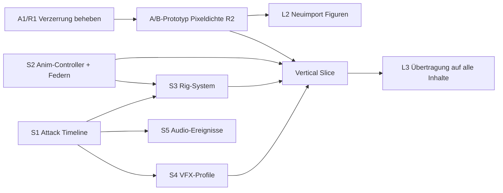

# Roadmap & Vertical Slice

Rang 2 unter [[Leitbild]].

**Grundsatz:** zuerst ein kleiner, hochwertiger Vertical Slice auf vorhandenen Inhalten, dann die systematische Übertragung. Keine oberflächliche Überarbeitung von allem gleichzeitig.

## 1. Einordnung der offenen Arbeit

| Kürzel | Art | Punkte |
|---|---|---|
| **A** | fundamentale Architekturprobleme | A1 Verzerrung 4:3→16:9 · A2 Pixeldichte uneinheitlich · A3 keine gemeinsame Zeitachse · A4 keine Animationsereignisse, Übergänge, Sekundärbewegung · A5 Bosse ohne artikulierten Körper |
| **V** | visuelle Qualitätsprobleme | V1 Zauber-VFX als gestreckte Blöcke und Vektorformen · V2 Stufe 1 zu groß, keine visuellen Bänder · V3 Minibosse und Ersatz-Gegner mit 0.1-Streifen (Stilbruch) · V4 Idle 1 Frame, keine Landung und kein Richtungswechsel · V5 prozedurale Ausrüstung ohne künstlerische Abnahme |
| **S** | fehlende wiederverwendbare Systeme | S1 Attack Timeline · S2 Animation Controller und Federmodul · S3 Rig-System · S4 VFX-Profile, Pixelpartikel, Qualitätsstufen · S5 Audio-Ereignisschicht · S6 Art-Lint |
| **E** | bestehende Systeme verbessern | E1 `attack_telegraph`/`bv2` um Intensivierung, Ton und Priorität · E2 `spell_vfx` → Emitter · E3 `fg_sfx` → Ereignisse · E4 Spielerprojektile als Struct-Pool (erst messen) |
| **K** | kurzfristig, klein | K1 Kamera-Konstanten statt fester 800/600 · K2 Hörabnahme der Synthese-Klänge · K3 Hierarchie: Dämpfung eigener Effekte bei Bossgefahr |
| **L** | langfristige Migrationen | L1 Quell-Assets in die Zielstruktur ([[Assets & Pipeline]] 4) · L2 Neuimport aller Figuren mit einheitlicher Dichte · L3 Übertragung auf alle Klassen, Gegner, Bosse und Zauber · L4 Waffen-Upgrade-System · L5 Elitegegner |

## 2. Abhängigkeiten

## 3. Phasen und empfohlene Reihenfolge der nächsten Aufträge

| Nr. | Auftrag (je ein eigener Prompt bzw. eine Aufgabe) | Größe | Abhängig von | Nutzerentscheidung |
|---|---|---|---|---|
| 1 | ~~R1 Verzerrung beheben~~ **erledigt 25.11.:** 960×540, Makros `VIEW_W`/`VIEW_H`, 16:9-Viewports | M | — | entschieden (b) |
| 2 | *(erledigt 25.11. für Figuren, Ausrüstung, die 4 prozeduralen Kreaturen, Drache und Behemoth; Pixelraster R2 Variante B umgesetzt; Zwillingshexen ebenfalls; offen: gezeichnete Skelett-Gegner (braucht neue Grafik))* **Umsetzung Pixeldichte:** Schwertkämpfer mit Faktor 1,0 aus den Quellatlanten (160er-Leinwand) neben dem heutigen 1,65; Varianten A und B des Feinrasters; Aufnahmen bei 720p und 1080p | M | 1 | **ja:** Auswahl nach Bildvergleich |
| 3 | *(erledigt 25.11.: Kern, Schwertkette und Klassen-Kombos)* **S1 Attack Timeline (Kern)** plus Migration der Schwertkette ohne Wertänderung; Telemetrie-Anker anpassen | M | — | nein |
| 4 | *(teilweise 25.11.: prozedurale Lebendigkeit, Haar und Umhang gefedert über Rig-Knochen; 26.11.: Trefferstopp als Bild, Bewegungsidentität von Hexen und Behemoth beim Aufladen und Einschlag)* **S2 Animation Controller plus Federmodul**; Spieler: Übergangsposen (Landung, Richtungswechsel), Haar und Umhang als Ebenen (Segmentierung aus `tests/tools/characters/`) | L | 2, 3 | nein |
| 5 | *(teilweise 25.11.: Pixelpartikel, Kettenblitz in 3 Bändern, Intensitäts-Bänder aller Zauber, Tonvariation, Musikabsenkung; zusammengesetzte Effekte für alle 18 Zauber, Effektqualität Niedrig/Mittel/Hoch; offen: Talent-Merkmale, Lichtauflösung)* **S4 VFX-Profile** für alle Zauber, Qualitätsstufen; **S5** Band-Varianten und Musikabsenkung | M | 3 | nein |
| 6 | **Vertical Slice bauen** (Abschnitt 4) | L | 1–5 | Abnahme |
| 7 | *(Stufe 1 am 25.11.: Drachen-Skinning-Rig; abends ersetzt durch den Drachen als Verbund aus Teilen mit Kopf- und Hals-Trefferformen, siehe [[Boss-Design]] G2; offen: Schweif als Gliederkette, Flügel als Teile)* **S3 Ausbau:** Hitboxen an Knochen, Schweifschlag, Biss, Knochen für alle Posen | L | 3, 4 | entschieden: eigenes Rig in GML (kostenlos) |
| 8 | Auswertung des Slice, Anpassung der Standards, dann **L3 Übertragung** je Inhaltsgruppe (Klassen → Gegner → Bosse → Zauber) | XL | 6, 7 | Reihenfolge |
| 9 | V3 Minibosse (Anforderungen seit 26.11. in [[Assets & Pipeline]] 7.6); ~~L5 Elitegegner~~ und ~~L4 Waffen-Upgrades~~ umgesetzt am 25.11. | L | 8 | entschieden |
| 10 | ~~L1 Asset-Migration~~ **erledigt 26.11.:** Pfadtabelle, Probelauf, Verschieben in die Zielstruktur ([[Assets & Pipeline]] Abschnitt 4). `atmosphere_v2/` ist eine aktive Quelle und liegt jetzt unter `bosses/`. | M | — | nein |
| 11 | ~~Basemodel ohne Ausrüstung~~ **verworfen 26.11. abends (Nutzer):** Die heutigen Figuren bleiben, Rüstung ist unsichtbar, Waffen bleiben sichtbar ([[Visuelles Leitbild & Animation]] 5.5a). | – | – | entschieden |
| 12 | **Drache Stufe 2:** Schweif als Gliederkette mit Trefferfläche an der Spitze und Flügel als eigene Teile. Braucht eigene Quellsegmente; der Schweif liegt in der Dreiviertelansicht eingerollt zwischen den Beinen (Phase 2B, 4). Anforderungen für Schweif, Flügel und Kopf-Draufsicht: [[Assets & Pipeline]] 7.2–7.4. | L | neue Quellsegmente | offen |
| 13 | **Ankerpunkte nutzen:** weitere Waffentypen, Nebenhand und Schilde über `eqv_attach` (Daten seit 26.11. vorbereitet). | M | 11 | vorbereitet |
| 14 | **Grafik-Overhaul HD-2D (Auftrag 26.11. abends):** Maßstab Octopath Traveler für Licht, Atmosphäre und Angriffseffekte ([[Visuelles Leitbild & Animation]] 7). *Umgesetzt 26.11.:* Grundlage (Nachbearbeitung, verstärkbares Licht, Pixelpartikel, Atmosphäre je Level, Figuren-Effekte) und Schaustück (Drachen-Feueratem, Feuerball, Kettenblitz, Eisball, Licht der drei Level). *27.11. (Nutzer):* Richtung bestätigt, Ausrollen beendet. Zauber/Passiva und alle Gegnerangriffe sind herausgelöst (Zeilen 15 und 16). *Umgesetzt 27.11.:* Startwaffen, Gegnertreffer und -tode, Münzen, Pickups, Level-up, pixelgenau wiegende Pflanzen, Figuren-Effekte von Arkanistin und Waldläufer geprüft (Trefferaufblitzen verkürzt). *Offen:* neue Figurengrafik nach [[Assets & Pipeline]] 7.8 (BLOCKED: Quelle entscheidet der Nutzer, hier kein Bildwerkzeug); Leistung im Münz-Belastungstest ([[Bugs & Ideen]]). | L | — | **ja:** der Nutzer entscheidet, was als Nächstes kommt |
| 15 | **Gegner-, Miniboss- und Bossangriffe samt Gefahrenflächen** (herausgelöst 27.11., eigener Auftrag des Nutzers): HD-2D-Aufbau nach [[Visuelles Leitbild & Animation]] 7.2 und **„Die Attacke ist die Warnung“** ([[Kampf & Begegnungen]] 5.0, [[Boss-Design]] B2, Leitbild G19). Die Markerwarnungen (Grundfärbung, Füll-Countdown, Fokus-Umriss, Fächer mit Pfeilen) werden durch Vorzeichen der Attacke ersetzt; Ablauf, Timing und Trefferflächen bleiben. Je Gefahr Ausweich-Orakel und visual-qa-Zweitmeinung. Offene Fragen entschieden 27.11. (Kampf & Begegnungen 5.0, [[DECISIONS]]). *Stand 27.11.:* **Drache umgesetzt** (Pilot: Vorzeichen und aktive Darstellung aller 9 Attacken plus Biss und Schweif, `scripts/hazard_looks`; Boss-Suite mit Orakel PASS, zwei visual-qa-Runden). Zwillingshexen, Sumpfbehemoth, Minibosse und Gegner zeigen noch Markerwarnungen; **ihre Umstellung entscheidet der Nutzer.** Drachen-Restpunkte (Maul-Ursprung, Biss-Hals, Abbruch bei Navigation) in [[Bugs & Ideen]]. | XL | Auftrag des Nutzers | **ja:** Auftrag kommt vom Nutzer |
| 16 | **Zauber und Passiva im HD-2D-Aufbau** (herausgelöst 27.11., eigener Auftrag des Nutzers): die übrigen 15 aktiven Zauber und alle 18 Passiva; Feuerball, Eisball und Kettenblitz sind im Schaustück umgesetzt. *Stand 27.11.:* Pixelpartikel für Einschläge, lebende Zauber und sichtbar wirkende Passiva (`scripts/fx_spells`, [[Fähigkeiten, VFX & Audio]]), eigene Lichtblitze unter Bossgefahren gedämpft. Neue Zaubergrafik (Sprites) ist nicht Teil davon. | L | Auftrag des Nutzers | **ja:** Auftrag kommt vom Nutzer |

## 4. Vertical Slice: Spezifikation

**Ziel:** beweisen, dass die Architektur die gewünschte visuelle und spielerische Qualität erreicht. Alles baut auf vorhandenen Inhalten auf.

| Baustein | Inhalt | Abnahmekriterium (zusätzlich zum [[Qualitätsstandard]]) |
|---|---|---|
| Spielfigur | **Schwertkämpfer** im Wald, Pixeldichte nach Entscheidung 2 | Q1–Q4; Seite an Seite mit altem Stand aufgenommen |
| Bewegung | Laufen mit Neigung beim Beschleunigen und Abbremsen; Richtungswechsel mit Nachziehen von Umhang und Haar | Umhang erreicht seine Endlage 3–6 Frames nach dem Körper; Eingabe → Bewegung im selben Frame |
| Sprung | Einknicken (rein visuell), Flug, Scheitel, Fall, Landung mit Abfedern und Staub, Haar und Umhang reagieren | Sprungdauer unverändert 0,66 s; keine Eingabesperre; Aufnahme der Sequenz mit 30 Bildern/s |
| Schneller physischer Angriff | 1. Hieb der Kette: Körperrotation, Verwischungsbild, Trefferstopp beim Gegner (1–3 Frames, nur Gegner und Effekt), Materialklang | Angriffstakt und Schaden unverändert (Suite `classes`); Timeline-Ereignisse synchron |
| Mehrphasige magische Fähigkeit | **Kettenblitz** (aktiver Zauber): Aktivierung, Freisetzung, Sprung zwischen Zielen, Einschlag, Nachglühen | Phasen nach [[Fähigkeiten, VFX & Audio]] 1; Spezifikation Blitz 2 |
| Dynamischer Blitzeffekt | Bausteine Kern, Verästelung, Lichtpuls, Funken, Einschlag, Nachglühen, Ton | Auf dem Raster; wirkt als **ein** Blitz (Nutzerurteil) |
| Fähigkeit mit Progression | Kettenblitz in den Bändern Basis, Mittel und Endgame | Drei Aufnahmen nebeneinander; Basis kompakt, Endgame beeindruckend, **keine Wertänderung** |
| Normaler Gegner | **Skelettkrieger:** anatomiepassender Gang (klappernd), Ausholen vor dem Schlag, Trefferreaktion (Knochensplitter), Tod | Lauf ≥ 6 Frames je Richtung bzw. prozedural ergänzt; Kriterien des Gegnertyps |
| Artikulierter Boss | **Drache** als Rig aus der vorhandenen Grafik: Kopf und Hals (Blick, Biss), Rumpf (Gewicht), Flügel (Phasen), Beine (IK, Fußanker), Schweif (Federkette) | Bestehendes Modell erkennbar erhalten; keine sichtbaren Nähte; Hitboxen an Bones |
| Bossangriffe | **Schweifschlag** (neu, physisch, Sektor-Warnung, Hitbox an der Schweifspitze), **Biss** (Vorstoß), **Feueratem** (vorhanden, vom Körper vorbereitet) | Q5/Q6; Schweifschlag ist ausgeholt und räumlich nachvollziehbar |
| Mehrstufige räumliche Mechanik | **Magma-Schachbrett plus invertiertes Brett plus Schwenkstrahl**, während die Skeletthorde verfolgt | Erreichbarkeits-Orakel PASS mit Horde; keine Phase ohne sichere Fläche |
| Ton | Ereignisschicht für alle Slice-Ereignisse; Ankündigungston für Schweifschlag und Atem | Drosselung messbar; Hörabnahme |
| Leistung | Slice-Szene mit 150 Gegnern, Endgame-Kettenblitz, Drachenmechanik | Budget aus [[Technische Architektur]] 6 |

**Hinweis:** Der Schweifschlag ist ein **neuer Angriff in der Darstellung**. Ob er eine der neun Fähigkeiten ersetzt oder eine Variante einer vorhandenen wird, entscheidet der Nutzer. Neue Schadenswerte werden nicht ohne Auftrag festgelegt; für den Slice wird der Schaden einer vorhandenen Drachenfähigkeit wiederverwendet.

**Abnahme des Slice:** alle Kriterien „visuell geprüft“ durch die Agenten, danach **künstlerische Abnahme durch den Nutzer**. Erst dann beginnt L3.

## 5. Risiken

| Risiko | Gegenmaßnahme |
|---|---|
| R1 verändert Sichtbereich und Spawngefühl | Option b (ähnliche Fläche), Suiten `level`/`boss`, kurzer Spieltest |
| Neuimport mit neuer Pixeldichte verändert Figurengröße relativ zu Hitboxen | Hitboxen bleiben in Welteinheiten unverändert; Größe nur bei Bedarf und nach Nutzerentscheidung |
| Rig wirkt wie eine Papierpuppe | gemeinsame Render-Fläche (R3), Überlappungszonen gezeichnet, Rumpfreaktion, Abnahme durch den Nutzer |
| Timeline-Migration bricht Telemetrie-Anker | Anker im selben Auftrag anpassen, Regression mit 811 Prüfungen |
| Mehr Effekte kosten Leistung | Budgets, Qualitätsstufen, Messung im Slice |
| KI-generierte Quellen bleiben uneinheitlich | Pixeldichte-Standard, Art-Lint, Nutzerabnahme |
