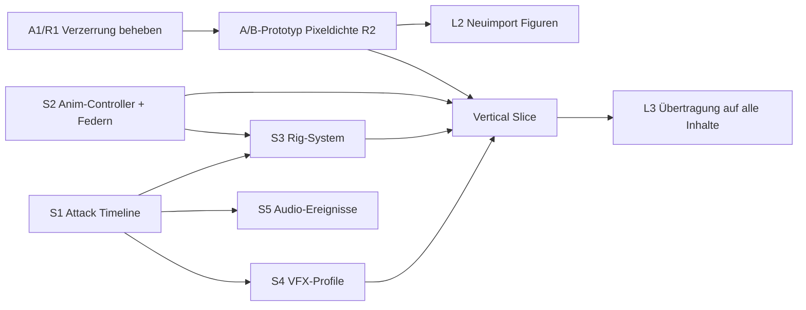

# FirstGame – Designphilosophie (konsolidierter Export, Stand 2026-11-25)

> **Momentaufnahme, nicht verbindlich.** Maßgeblich sind die einzelnen Dateien unter `docs/Design/` (Vorrang: Leitbild). Dieser Text wurde mit `python tests/tools/export_design.py` erzeugt und wird bei Änderungen neu erzeugt, nicht von Hand bearbeitet. Verweise in „Anführungszeichen“ nennen Dokumente des Kanons bzw. Systemnotizen unter `docs/Systeme/`.

## Inhalt
1. Leitbild
2. Kampf & Begegnungen
3. Boss-Design
4. Klassen
5. Progression & Builds
6. Visuelles Leitbild & Animation
7. Fähigkeiten, VFX & Audio
8. Technische Architektur
9. Assets & Pipeline
10. Qualitätsstandard
11. Roadmap & Vertical Slice

---

## 1. Leitbild: globale Designphilosophie

Dieses Dokument ist die oberste verbindliche Designquelle für FirstGame. Es gilt für alle Klassen, Gegner, Bosse, Fähigkeiten, Grafiken, Animationen, Effekte und Klänge, auch für künftige. Fachdokumente regeln die Details; sie dürfen diesem Dokument nicht widersprechen.

### 1. Vorrang und Status der Dokumente

| Rang | Dokument | Status | Bedeutung |
|---|---|---|---|
| 1 | `docs/Design/Leitbild.md` (dieses Dokument) | verbindlich, global | Gewinnt bei jedem Widerspruch zwischen Designdokumenten. |
| 2 | übrige `docs/Design/*.md` | verbindlich, je Fachgebiet | Im eigenen Fachgebiet maßgeblich. Das spezifischere Dokument gilt im Detail, solange es Rang 1 nicht widerspricht. |
| 3 | `docs/DECISIONS.md` | verbindlich als Entscheidungsprotokoll | Eine neue Entscheidung gilt sofort. Das betroffene Designdokument wird im selben Auftrag nachgezogen. |
| 4 | `docs/Systeme/*.md` | beschreibend (Ist-Zustand) | Zeigt, wo etwas im Code steht. Keine Anforderungen. |
| 5 | `docs/HANDOFF.md`, `docs/LOG.md` | Stand und Verlauf | Keine Anforderungen. |
| 6 | `docs/Bugs & Ideen.md` | unverbindlich | Gesammelte Fehler und Ideen. |
| 7 | Root-`*_REPORT.md`, `DEVELOPMENT_PROGRESS.md`, `TODO.md`, `QA/*.md`, `FirstGame_ArtPack/**/*.md`, `docs/_archive/`, `docs/_export/` | historisch oder Momentaufnahme | Werte und Aussagen können veraltet sein. |

- **`AGENTS.md`** regelt die Arbeitsweise (Werkzeuge, Tests, Git, Übergabe). Es ist kein Designdokument, ist für die Arbeitsweise aber maßgeblich.
- **Soll und Ist:** Designdokumente beschreiben das Soll. Der Code ist die Wahrheit für das Ist. Weicht der Code vom Soll ab, ist das eine Lücke. Sie wird in „Roadmap & Vertical Slice“ oder „Bugs & Ideen“ erfasst, nie stillschweigend durch Umschreiben des Solls beseitigt.
- **Kennzeichnung in Designdokumenten:**
  - **Soll**: Anforderung.
  - **Ist (Datum)**: gemessener oder gelesener Stand.
  - **Offen**: wartet auf eine Entscheidung des Nutzers.
  - **Vorschlag**: Empfehlung eines Agenten, noch nicht bestätigt.
- **Neue Nutzeranforderungen** (Prompts) haben bei echten Widersprüchen Vorrang vor älteren Dokumenten. Sie werden im selben Auftrag mit Datum in das passende Designdokument übernommen, dazu eine Zeile in `DECISIONS.md`. Eine wesentliche Entscheidung darf nicht nur im Chat stehen.
- **Herkunft:** Wo eine Regel aus einem früheren Auftrag stammt, steht das Datum dabei (z. B. „Auftrag 22.11.“). Quellen waren die Codex-Aufträge vom 22./23.11. und die Claude-Aufträge vom 23.–25.11.2026. Nicht zugängliche Gespräche wurden nicht rekonstruiert.

### 2. Spielidentität

FirstGame ist ein eigenständiges **Pixel-Art-Action-RPG im Run-Format**:
- Top-down, Runs von 30 Minuten.
- Wachsende Gegnerhorden bilden die Survivors-Schicht, die Klassenwaffen greifen automatisch an.
- Bauen eines Builds aus Zaubern, Passiva, Talenten und Ausrüstung.
- Als Höhepunkt jeder Runde: anspruchsvolle, lernbare Bosskämpfe.

Das langfristige Ziel (Auftrag 25.11.):
- hochwertige, lebendige und kohärente Pixel-Art;
- anspruchsvolle Bosskämpfe;
- ausgeprägte Charakterprogression;
- überzeugende audiovisuelle Kampfinszenierung.

**Nicht mehr Pixel-Art, sondern besser inszenierte Pixel-Art.**

- **Entschieden (Nutzer, 25.11.): beides.**
  - Das Run-Format bleibt (30 Minuten, automatische Angriffe).
  - **Dazu kommt Fortschritt zwischen den Runs:** Talente und Talentpunkte bleiben je Klasse erhalten, ein Zurücksetzen ist jederzeit möglich. Details: „Progression & Builds“.
  - Manuelles Zielen ist weiterhin nicht vorgesehen.

### 3. Die drei Inspirationsquellen und wie sie zusammenwirken

| Quelle | Das übernehmen wir | Das übernehmen wir nicht |
|---|---|---|
| **Soulslike** | Erkennbare Angriffsvorbereitung durch Körperbewegung, Bedeutung von Timing, Konsequenz bei Fehlern, lernbare Gegner, das Gefühl, einen Gegner zu meistern | Bestrafung durch Unlesbarkeit, lange Eingabesperren |
| **Final Fantasy XIV** | Räumlich strukturierte, mehrphasige Mechaniken, wechselnde sichere und gefährliche Flächen, überlappende Muster, Vorausplanung, klar kommunizierte Gefahrenbereiche | Fremde Effekte oder Assets, geschlossene Arena (unsere Welt ist offen), Gruppenrollen |
| **Path of Exile** | Build-Tiefe, Synergien, skalierende Fähigkeiten, bedeutsame Talente, spürbare mechanische und visuelle Progression | Bildschirmfüllende Spielereffekte, die Gegnerinformationen verdecken |
| **Survivors** (Basis) | Horden, Kiting, Flächenschaden, automatische Angriffe, kurze Runs | Gegnermassen als einzige Schwierigkeitsquelle |

**Synthese:** Der Kern des Spiels ist **räumliche Entscheidungsfindung unter Druck**. Jede Quelle liefert dazu einen Teil:
- Die Horde (Survivors) verengt den Bewegungsraum.
- Die Bossmuster (FFXIV) bestimmen, wo es sicher ist.
- Einzelne Angriffe (Soulslike) verlangen Timing.
- Der Build (PoE) bestimmt, wie viel Schaden man aus welcher Position machen kann.

Kein Teil steht für sich; Details in „Kampf & Begegnungen“.

### 4. Säulen (Prüfsteine für jede Entscheidung)

1. **Räumliche Entscheidungen unter Druck:** Der Spieler fragt sich ständig, wo er stehen kann, wohin er muss und ob er jetzt Schaden machen oder überleben will.
2. **Lesbarkeit vor Spektakel:** Schwierigkeit entsteht aus Verständnis, Positionierung, Reaktion und Timing, nicht aus unlesbarem Chaos.
3. **Fairness:** Es gibt immer eine realistisch ausführbare Überlebensstrategie und keinen grundsätzlich unvermeidbaren Schaden.
4. **Lebendige, zusammenhängende Körper:** Figuren wirken wie physische Körper mit Gewicht. Bewegung kommuniziert Absicht und Gefahr.
5. **Verdiente Eskalation:** Visuelle und akustische Wucht spiegelt die tatsächliche Macht wider. Stufe 1 ist kompakt, das Endgame beeindruckend.
6. **Aus einem Guss:** Alle Assets wirken wie Teile desselben Spiels (Pixelraster, Licht, Palette, Animationsqualität).
7. **Steuerung zuerst:** Keine Animation verzögert die Eingabe oder sperrt die Bewegung unnötig.
8. **Systeme statt Einzelanfertigungen:** Höhere Qualität entsteht über wiederverwendbare Bausteine, nicht über Sonderlösungen je Fähigkeit oder Gegner.

### 5. Globale Grundsätze

Diese Regeln gelten für alle Klassen, Gegner, Bosse und Fähigkeiten, auch künftige. Klassen- und Bossdokumente beschreiben nur ihre Besonderheiten.

| Nr. | Grundsatz | Detail |
|---|---|---|
| G1 | **Ankündigung = Wahrheit.** Animation, Warnfläche, Hitbox, Schadenszeitpunkt, Effekt und Ton hängen an derselben Zeitquelle (eine Uhr je Besitzer). Bei 100 % Warnung beginnt sofort die aktive Phase. Pause hält alles gemeinsam an. | „Kampf & Begegnungen“, „Technische Architektur“ |
| G2 | **Kein unvermeidbarer Schaden.** Keine zufälligen Kombinationen, die alle sicheren Positionen schließen. | „Kampf & Begegnungen“ |
| G3 | **Kiting bleibt legitim**, aber keine einfache Strategie neutralisiert alle Mechaniken. | „Boss-Design“ |
| G4 | **Trefferhöhen statt pauschaler Unverwundbarkeit:** Boden, hoch, alle; Sprung, Slide und Ausweichen wirken gezielt. | „Kampf & Begegnungen“ |
| G5 | **Eigene Effekte verdecken nie überlebenswichtige Informationen.** Es gilt die visuelle Hierarchie. | „Kampf & Begegnungen“ |
| G6 | **Visuelle Intensität folgt der tatsächlichen Macht.** Hitbox und sichtbare Schadensfläche stimmen überein. | „Fähigkeiten, VFX & Audio“ |
| G7 | **Jede Figur ist in jeder Animation dieselbe Figur:** gleiche Proportionen, Farben und Größe in allen Richtungen. Kleidung, Haare und Umhänge reagieren auf Bewegung. Früher nur für Zaubermeisterin und Waldläufer gefordert, gilt jetzt für alle. | „Klassen“, „Visuelles Leitbild & Animation“ |
| G8 | **Ein gemeinsames Pixelraster:** keine willkürlichen Pixelgrößen, keine verzerrte Darstellung. | „Visuelles Leitbild & Animation“ |
| G9 | **Fähigkeiten sind audiovisuelle Ereignisse** mit Phasen (Vorbereitung bis Abklingen). Ton und Bild werden gemeinsam entworfen. | „Fähigkeiten, VFX & Audio“ |
| G10 | **Nur freigegebene Grafikquellen:** FirstGame-ArtPack und daraus abgeleitete eigene Grafik. Keine alten Projektgrafiken als Ersatz, keine kopierten fremden Assets. Referenzen wie Terranigma dienen nur der Bewegungsqualität. | „Visuelles Leitbild & Animation“, „Assets & Pipeline“ |
| G11 | **Ehrlicher Status:** Ein Sprite, eine abspielende Animation oder verursachter Schaden heißt nicht „fertig“. Es gilt die Statusskala des „Qualitätsstandard“. | „Qualitätsstandard“ |
| G12 | **Keine Balancing-Zahlenänderungen ohne Auftrag** (HP, Schaden, XP, Klassenwerte, Skalierung, Drop-Raten). Darstellung darf sich ändern, Hitbox-Radien und Werte nicht. | `AGENTS.md` |
| G13 | **Performance-Budgets** gelten für jede neue Funktion (Partikel, Lichter, Stimmen, Instanzen). | „Technische Architektur“ |
| G14 | **Bestehendes Drachenmodell und Originalquellen bleiben erhalten.** Erweitern statt ersetzen. | „Assets & Pipeline“ |

### 6. Aufgelöste Widersprüche (Audit 25.11.2026)

| Frühere Anforderung | Neue bzw. gültige Regel | Grund |
|---|---|---|
| „Angriffe optisch viel zu klein, mehr visuelle Präsenz“ (Auftrag 22.11.); Zaubermeisterin „größer, eindrucksvoller“ | **Präsenz durch Klarheit, Kontrast, Timing und Ton statt Fläche.** Stufe 1 ist kompakt, aber sofort erkennbar. Die Größe wächst mit der Progression. | Auftrag 25.11. hat Vorrang. Die Erkennbarkeit aus dem 22.11. bleibt Pflicht. |
| „Zeitweise ein Großteil des Bildschirms von Projektilen bedeckt“ (Auftrag 22.11.) | **Kurze Dichte-Spitzen erlaubt, nie dauerhaft.** Ein erreichbarer Weg bleibt immer sichtbar. | `Boss-Design` F und Auftrag 25.11. (keine Schwierigkeit aus unlesbarem Chaos) |
| „Während Sprung und Slide unverwundbar“ (Auftrag 22.11., früh) | **Trefferhöhen** (Boden/hoch/alle). Nur die Ausweichrolle hat kurze, getrennt konfigurierbare Unverwundbarkeit. | Auftrag 22.11. (später), so umgesetzt |
| Warnfläche füllt sich vollständig radial (Auftrag 22.11., `CLASS_DRAGON_REPORT.md`) | **Dezente Warnung:** voller Umriss ab 0 %, Countdown am Rand, kontrollierte Intensivierung, Aufleuchten beim Einschlag. Normale Projektile bekommen keine Bodenwarnung. | Boss-System-2.0-Auftrag („teilweise zu präsent“), Bossphilosophie 23.11., Auftrag 25.11. |
| Drache: „sehr viele Sprites und Animationen sind ausdrücklich gewünscht“ | **Artikulierter Körper statt immer mehr Sprites.** Mehr Frames sind nur dort erwünscht, wo sie Qualität bringen. | Auftrag 25.11. |
| Anforderungen an Kleidung, Haare und „dieselbe Figur in jeder Animation“ nur für Zaubermeisterin und Waldläufer | **Global** (G7), auch für den Schwertkämpfer und künftige Klassen | Auftrag 25.11. |
| Visuelle Waffenstufen nach Spielerstufe 1/34/68, bewusst getrennt vom Waffenschaden (Auftrag 22.11.) | **Bleibt vorerst.** Soll: an die echte Waffenprogression koppeln, sobald das geplante Waffen-Upgrade-System existiert. | Auftrag 25.11. (Intensität folgt tatsächlichem Fortschritt) |
| `TALENTS_AND_EQUIPMENT.md`: „Ausrüstung am Charakter nicht sichtbar“; Systemnotiz Spieler | **Veraltet.** Seit 24.11. ist Ausrüstung als Ebenen sichtbar. Korrigiert. | Code-Stand |

### 7. Glossar

- **Klassen:** **Schwertmeister** (Code `Sword`, Figur `swordsmanv3`), **Arkanistin** (`Mage`, `magev3`), **Waldläufer** (`Ranger`, `rangerv3`).
  - Umbenannt am 25.11. (Nutzerentscheidung).
  - Frühere Namen in älteren Texten: Schwertkämpfer, Zaubermeisterin.
- **Gegnerränge:** normaler Gegner, Elite (noch nicht im Spiel), Miniboss (Minute 1 und 3), Hauptboss (ab Minute 5, alle 5 Minuten).
- **Warnung (Telegraph):** angekündigte Trefferfläche mit Countdown.
- **Aktive Phase:** Zeitraum, in dem eine Attacke Schaden verursachen kann.
- **Trefferhöhe:** `ground`, `high`, `all`.
- **Stufen:** Spielerstufe (XP), Zauberstufe 1–9, Talentrang, Gegenstandsstufe (Item-Level).
- **Welteinheit:** Koordinateneinheit des Raums.
- **Artpixel:** ein Pixel der Quellgrafik. Ihr Verhältnis regelt „Visuelles Leitbild & Animation“.

### 8. Die Designdokumente

| Dokument | Fachgebiet |
|---|---|
| „Kampf & Begegnungen“ | Kampfphilosophie, räumliche Entscheidungen, Warnungen, Fairness, Gegner- und Bossprinzipien, visuelle Hierarchie |
| „Boss-Design“ | Bossregeln im Detail und Umsetzungsstand je Hauptboss |
| „Klassen“ | Anforderungen an jede Klasse und Klassenprofile |
| „Progression & Builds“ | Level-ups, Zauber, Talente, Ausrüstung, Waffenentwicklung |
| „Visuelles Leitbild & Animation“ | Art Direction, Terranigma-Referenz, Pixelraster, Animationsanforderungen |
| „Fähigkeiten, VFX & Audio“ | Fähigkeiten als Ereignisse, VFX, visuelle Progression, Ton |
| „Technische Architektur“ | Ist-Architektur, Technikvergleich, Zielarchitektur, Budgets |
| „Assets & Pipeline“ | Asset-Bestand, Struktur, Namen, Arbeitsablauf, Migrationsplan |
| „Qualitätsstandard“ | Statusskala, Abnahmekriterien, Review-Prozess |
| „Roadmap & Vertical Slice“ | Priorisierte Schritte und Vertical-Slice-Spezifikation |

---

## 2. Kampf & Begegnungen

Rang 2 unter „Leitbild“. Bossdetails stehen in „Boss-Design“, die Darstellung der Effekte in „Fähigkeiten, VFX & Audio“.

### 1. Der zentrale Gameplay-Loop: räumliche Entscheidungen unter Druck

Der Spieler soll sich regelmäßig fragen:
- Welche Fläche ist gerade sicher, welche wird als Nächstes gefährlich?
- Wo kann ich stehen bleiben und Schaden machen?
- Welche Gegner verfolgen mich, und wie viel freier Raum bleibt mir?
- Erreiche ich den sicheren Bereich rechtzeitig, oder muss ich springen, sliden oder ausweichen?
- Muss ich meine Position schon vor dem nächsten Angriff ändern?
- Verzichte ich kurz auf Schaden, um zu überleben?

**Das Zusammenspiel ist der Kern.** Beispiel: Ein Boss legt ein Schachbrettmuster, während die Horde den Spieler verfolgt. Der Spieler muss das Muster verstehen und zugleich entscheiden, wie er im verbleibenden sicheren Raum mit den Gegnern umgeht.

**Regel für Inhalte:** Jede neue Bossmechanik wird mit Horde gedacht und getestet, nicht nur isoliert.

**Herkunft:**
- Auftrag 22.11.: „die eigentliche Schwierigkeit von FirstGame“, Gegnergruppen schränken die sicheren Bewegungen ein.
- Bossphilosophie 23.11.
- Auftrag 25.11.

### 2. Bewegungswerkzeuge des Spielers

| Werkzeug | Ist (25.11.) | Soll |
|---|---|---|
| Laufen | Schwertkämpfer ca. 192, Zaubermeisterin 168, Waldläufer 252 px/s; freie Bewegung, Maussteuerung optional | Sichtbare Beschleunigung und Abbremsung **nur in der Darstellung**. Die Steuerung bleibt direkt (kein Rutschen, keine Eingabeverzögerung). |
| Sprung (Leertaste) | 0,66 s, Höhe nur visuell, überspringt Bodenangriffe | Werkzeug zur Positionierung mit begrenzter Weite, keine Endlosketten. Visuell: Vorbereitung, Flug, Landung (siehe „Visuelles Leitbild & Animation“). |
| Slide | nur durch zweite Eingabe im Zeitfenster, unterläuft hohe Angriffe | unverändert; nie automatisch nach einem Sprung |
| Ausweichrolle (Strg) | 1,5 s Abklingzeit, kurze, getrennt konfigurierbare Unverwundbarkeit | Bleibt das einzige Werkzeug mit pauschalem Schutz, klar begrenzt. |
| Automatische Angriffe | laufen in allen zulässigen Bewegungszuständen | Angriffe sperren die Bewegung nie. |

**Trefferhöhen** (G4): Jeder Gefahrenbereich hat `ground`, `high` oder `all`.
- **Sprung** schützt vor `ground` (Schockwellen).
- **Slide** schützt vor `high` (Strahlen über dem Boden).
- **`all`** trifft immer. Diese Höhe gilt für Magma, Meteore und große Flächen, die man verlassen muss.
- **Darstellung:** Die Höhe muss sichtbar sein, z. B. durch Bodenschatten, Flughöhe, die Form der Warnung oder einen Hinweis in der Animation.

### 3. Kiting und Distanz

- **Kiting, Fernkampf und freie Bewegung sind legitim.** Kein Zwang in den Nahkampf, keine künstliche Reichweitengrenze.
- **Gegen das „Kreisen auf maximaler Distanz“** helfen interessantere Mechaniken:
  - weit reichende, schwenkende Strahlen (über den sichtbaren Bereich hinaus);
  - gezielt platzierte Bodenangriffe;
  - großflächige Muster;
  - seltene, klar angekündigte Aufhol- und Repositionierungsangriffe.
- **Bodenangriffe bleiben lokal und zeitlich präzise lesbar.**
- Details und Umsetzungsstand: „Boss-Design“ A–C.

### 4. Physische und magische Angriffe

Diese Einteilung ist eine Richtlinie, keine starre Regel. Entscheidend sind Abwechslung, Lesbarkeit und eine passende Inszenierung.

| | Physisch (Hieb, Klaue, Biss, Ansturm, Schweif) | Magisch (Strahl, Feld, Meteor, Nova) |
|---|---|---|
| Typische Ankündigung | **Körperbewegung**: Ausholen, Gewichtsverlagerung, kurzer Ton-Cue. Bodenmarkierung nur bei großer Reichweite. | Warnfläche mit Countdown, Aufladen, Lichtaufbau |
| Tempo | schnell, kurze aktive Fenster, verlangt Reaktion | oft mehrphasig, verzögert, verkettet; darf auch schnell sein |
| Fläche | klein bis mittel, folgt dem Körperteil (Schweifbahn, Klauenbogen) | mittel bis riesig, Muster, Zonen |
| Gegenspiel | rechtzeitig ausweichen, Sprung oder Slide nach Höhe | Position planen, sichere Fläche erreichen |
| Gefühl | kinetische Energie, Wucht, Trefferstopp | Energieaufbau, Entladung, Nachwirkung |

### 5. Warnungen (Telegraphs): globale Regeln

1. **Synchron (G1):** Warnung, Hitbox, Schaden, Effekt und Ton laufen über dieselbe Uhr des Besitzers.
   - Bei 100 % wird die Attacke im selben Update aktiv, ohne versteckte Wartezeit.
   - Vor 100 % gibt es keinen Schaden aus der angekündigten Fläche.
   - Pause hält alles gemeinsam an.
   - Ist: so umgesetzt für Bossgefahren (`v2_clock`, `attack_telegraph`, `bv2_*`), nativ getestet.
2. **Nicht jeder Angriff braucht eine Bodenwarnung.**
   - Normale Projektile haben eine sichtbare Flugbahn und Höhe (Schatten), aber keine Bodenwarnung.
   - Schnelle physische Angriffe werden über den Körper angekündigt.
3. **Flächen- und Spezialangriffe:**
   - voller Umriss ab 0 %;
   - dezenter Countdown am Rand;
   - kontrollierte Intensivierung zum Ende hin;
   - präzises Aufleuchten im Treffermoment.
   - Keine großen, deckenden Vollflächen.
4. **Strahlen:**
   - Konzeptionell unbegrenzte Reichweite (Geometrie, kein weltlanges Sprite).
   - Der Schwenk-Sektor wird angekündigt; der Schwenk ist erkennbar und nicht schneller als nötig.
   - Pro Überstreichen trifft ein Strahl höchstens einmal.
5. **Zielpunkte** werden zu einem nachvollziehbaren Zeitpunkt festgelegt (Zielerfassung, Ankündigung, Festlegung, Angriff).
   - Eine kontrollierte Nachführung ist nur erlaubt, wenn sie angekündigt und ausweichbar ist.
   - Felder springen nie ohne neue Warnung auf den Spieler.
6. **Warnzeiten-Richtwerte** (Ausgangswerte aus dem Auftrag vom 22.11., keine Balancing-Vorgabe):

   | Art | Richtwert |
   |---|---|
   | schneller Projektilangriff | 0,5 s |
   | gewöhnlicher Flächenangriff | 1,0 s |
   | großer Strahl | 1,2 s |
   | Meteoritenregen | 1,8 s |
   | besonders gefährlicher Spezialangriff | 2,5 s |

   Später kürzere Warnzeiten sind erlaubt, solange sie lesbar bleiben.
7. **Gegnerwarnung und Spielereffekt haben verschiedene Formsprachen.**
   - Die Kombination aus vollem Umriss und Rand-Countdown ist Gegnergefahren vorbehalten.
   - Spielerflächen (z. B. das Zielmal des Pfeilhagels) nutzen eine eigene Markierung.

### 6. Fairness und Dichte

- **Realistisch erreichbar:** Für jede Sequenz muss eine sichere Position erreichbar sein, mit:
  - der langsamsten Klasse;
  - der tatsächlichen Hitbox;
  - Hindernissen;
  - gleichzeitig verfolgenden Gegnern;
  - ohne perfektes Vorwissen.
- **Vorschlag als Testkriterium:**
  - Weglänge geteilt durch die Laufgeschwindigkeit der langsamsten Klasse plus 0,3 s Reaktionszeit muss kürzer sein als die Warnzeit.
  - Zählt ein Sprung oder Slide mit, gelten dessen Dauer und Abklingzeit.
  - Die Boss-Suite prüft das bereits für die Muster (Orakel); neue Mechaniken nutzen dasselbe Verfahren.
- **Wechsel der Intensität:** freie Bewegung → Einzelangriffe → Spezialangriff → kurze Kombination → Erholung.
- **Dichte:**
  - Kurze Spitzen mit hoher Projektil- oder Flächendichte sind erlaubt.
  - Dauerhaft fast vollständig gefährliche Bildschirme sind es nicht.
- **Überlappende Phasen sind erwünscht:** A aktiv, B angekündigt, A endet, B aktiv.
  - Es dürfen nie versehentlich alle sicheren Positionen gleichzeitig verschwinden.
  - Ein zufälliges Zusammentreffen zweier Mechaniken muss diese Regel ebenfalls einhalten. Das ist ein Grund, Bossrotationen zu planen statt zu würfeln.
- **Ursachenanalyse vor Zahlen:**
  - Trifft ein Angriff unverhältnismäßig oft, werden zuerst Warnzeit, Fläche, Animation, Synchronität und Überlappung geprüft, nicht der Schaden.
  - Trifft ein schwerer Angriff praktisch nie, ist er bedeutungslos. Auch das ist ein Fehler.

### 7. Gegnerdesign

#### Normale Gegner
- **Rolle:** Sie bilden Horden, lassen sich sammeln und kiten und verengen den Raum. Ihre Bewegung ist flüssig, mit dezenter Trennung, ohne Zittern und ohne Stapeln.
- **Individualität (Soll, Auftrag 25.11.):** Gegner unterscheiden sich durch Anatomie, Masse, Bewegungsweise und Angriffscharakter, nicht nur durch Sprite, Schaden und Tempo. Ein Wolf bewegt sich anders als ein Skelett, eine Spinne, ein Flieger oder eine magische Kreatur.
- **Angriffe:**
  - Kontaktschaden ist die Grundlage.
  - Gegner mit eigenem Angriff kündigen ihn über den Körper an (kurzes Ausholen).
- **Lesbarkeit:** Statuseffekte bleiben in der Silhouette des Monsters. Die Grundfarbe bleibt erkennbar (Auftrag 22.11.).

#### Elitegegner (Nutzerentscheidung 25.11., umgesetzt)
- **Auftreten:** Ab Minute 3 wird **jeder 60. neue Gegner** zur Elite (fester Zähler statt Zufall, Simulationen bleiben vergleichbar). Das gilt für alle Level.
- **Werte (neue, ungetestete Designwerte, `elite_config` in `scripts/survivor_balance`):**
  - 3-fache Lebenspunkte;
  - 1,25-facher Schaden;
  - 1,2-fache Größe;
  - 10 % Chance auf Ausrüstung, mindestens magisch.
- **Erkennbarkeit:** goldener, pulsierender Silhouettenrand (Fog-Umriss).
- **Fähigkeit,** abwechselnd eine von zwei:
  - **Sprungangriff:** In 120–360 px Abstand wird ein Zielkreis (70 px) auf deine Position angekündigt (0,9 s). Die Elite springt im Bogen dorthin; bei der Landung entsteht eine Bodenwelle, die ein Sprung überwindet. Danach 5 s Pause.
  - **Giftfläche beim Tod:** Ein Kreis (85 px) wird 0,6 s angekündigt und bleibt 3 s giftig.
- **Technik:** Beides läuft über das gemeinsame bv2-Gefahrensystem mit denselben Warn-, Treffer- und Pausenregeln wie bei Bossen. Uhrgeber ist der Spawner.

#### Minibosse
- **Zeitplan:** Minute 1 und 3.
- **Größe:** deutlich größer als normale Gegner.
- **Angriff:** ein eigener automatischer Grundangriff plus Spezialangriffe.
- **Ist:** Sie nutzen teils noch die Gegnerstreifen aus ArtPack 0.1 (64×64, ohne Blickrichtungen). Das ist ein Stilbruch; siehe „Roadmap & Vertical Slice“.

#### Hauptbosse (Prinzipien; Details in „Boss-Design“)
- **Fähigkeiten:**
  - genau neun je Hauptboss;
  - Freischaltung 3/6/9 in Minute 5/10/15;
  - früh freigeschaltete Fähigkeiten dürfen später komplexere Varianten bekommen.
- **Rotationen:** lernbare Abfolgen, keine Zufallsfolgen. Jeder Boss hat eine eigene spielerische Identität.
- **Körper als Kommunikation (Soll, Auftrag 25.11.):**
  - Große Bosse haben artikulierte Körper.
  - Der Angriff ist im Körper sichtbar: Ausholen, Gewichtsverlagerung, das Körperteil, das trifft.
  - Die Hitbox folgt dem sichtbaren Körperteil (z. B. der Schweifspitze).
- **Größe:**
  - Hauptbosse dominieren das Feld.
  - Besonders große Bosse dürfen etwa ein Viertel der sichtbaren Fläche einnehmen (Auftrag 22.11.).
- **Präsenz:** Der Spieler darf den Boss nicht dauerhaft aus dem Bild ziehen.
  - Aufholattacken haben Vorrang vor dem Teleport.
  - Der Teleport ist nur ein Notfall.

### 8. Visuelle Hierarchie und Lesbarkeit

Rangfolge, was bei Konflikten sichtbar bleiben muss (1 = höchste):

1. **Spielerfigur und ihr Bodenkreis/Schatten:** immer erkennbar, auch unter Effekten.
2. **Tödliche Bossmechaniken:** aktive Gefahrenflächen, Strahlen, Einschläge.
3. **Angekündigte Gefahren:** Warnumrisse, Countdown-Rand, nächste Gefahr.
4. **Angriffsvorbereitung von Gegnern:** Ausholen, Aufladen, Augenleuchten.
5. **Gegnerprojektile.**
6. **Gegner:** Silhouetten, Lebensleisten nur bei Bedarf.
7. **Eigene Fähigkeiten:** Kern und Einschlag.
8. **Sekundäre Partikel**, Nachglühen, eigene Lichter.
9. **Umgebung und Hintergrund.**

**Regeln:**
- **Zeichenreihenfolge folgt der Rangfolge.** Gegnerwarnungen und Bossgefahren liegen über den eigenen Effekten.
  - Ist: `ObjectController/Draw_73` zeichnet Zauber vor den Bossgefahren. Bossgefahren liegen also schon darüber.
- **Eigene Bodeneffekte** bleiben halbtransparent und unter einer Deckkraft-Obergrenze (Richtwerte in „Fähigkeiten, VFX & Audio“). Sie benutzen nie die Formsprache gegnerischer Warnungen.
- **Farben haben Bedeutung.** Elementfarben gelten für Freund und Feind. Unterschieden werden beide durch die Formsprache (Umriss plus Rand-Countdown = Gefahr) und die Intensität, nicht nur durch die Farbe.
- **Endgame-Effekte** dürfen beeindrucken, aber sichere Flächen bleiben erkennbar.
  - **Vorschlag:** Bei aktiven Bossgefahren werden eigene Effekte automatisch gedämpft (Deckkraft, Partikelzahl).
- **Ist-Mangel:** Die Darstellung ist derzeit horizontal um 33 % gestreckt. Kreise erscheinen als Ellipsen, und Entfernungen in x und y wirken verschieden.
  - Das verfälscht die Einschätzung von Abständen und sicheren Flächen.
  - Behebung: R1 in „Technische Architektur“.

### 9. Trefferrückmeldung

- **Treffer sind spürbar:** Trefferreaktion des Gegners, Einschlagseffekt, Ton, Schadenszahlen.
- **Vorschlag für physische Treffer:**
  - kurzer Trefferstopp (Hitstop) von 1–3 Frames nur für Gegner und Effekt, nie für die Spielersteuerung;
  - kleiner Rückstoß;
  - Materialklang (Knochen, Rüstung, Fleisch, Stein).
- **Der Spieler** bekommt beim eigenen Treffer klares rotes Feedback. Ist: Trefferblitz und HUD.

---

## 3. Boss-Design: Bosskampf-Philosophie und Umsetzungsstand

**Quelle:** Vorgabe des Projektinhabers vom 23.11.2026, ergänzt am 25.11.2026 um artikulierte Bosskörper (Abschnitt G2).

**Geltung:** Für Bossarbeit ist dieses Dokument maßgeblich (Rang 2 unter „Leitbild“). Die allgemeinen Kampf-, Warn- und Fairnessregeln für alle Gegner stehen in „Kampf & Begegnungen“. Hier stehen nur die Besonderheiten der Hauptbosse.

### Leitbild

FirstGame ist ein Survivors-Spiel mit anspruchsvollen, mechanisch durchdachten Action-RPG-Bosskämpfen. Bezugspunkt ist die **spielerische Struktur** anspruchsvoller Final-Fantasy-XIV-Begegnungen, nicht deren Effekte. Die Schwierigkeit entsteht aus Bewegung, räumlichem Denken, Timing und erlernbaren Mustern. Sie entsteht nicht aus hohen Schadenswerten, Zufallsspam oder künstlich begrenzter Spielerreichweite.

Die Leitfragen für den Spieler:
- Wo stehe ich?
- Wohin kann ich ausweichen?
- Welche Zone wird gleich gefährlich, und welche danach wieder sicher?
- Muss ich springen, sliden oder laufen?
- Kann ich noch Schaden machen?

### A – Kiting erhalten, Max-Range-Exploits verhindern

- **Kiting bleibt erwünscht.** Das heißt: auf Distanz kämpfen, Gruppen umkreisen (im und gegen den Uhrzeigersinn), offene Flächen nutzen. Spieler werden nicht in den Nahkampf gezwungen.
- **Das Problem:** Ein Spieler bleibt dauerhaft maximal entfernt, kitet die Horde und weicht so allen Bossmechaniken aus.
- **Die Lösung sind interessantere Mechaniken**, keine künstliche Reichweitenbegrenzung.
- Jeder Hauptboss braucht Mittel gegen weit entfernte Spieler: weit reichende Strahlen, gezielt platzierte Bodenangriffe, großflächige Muster, Projektilkombinationen, kontrollierte Repositionierung und seltene Aufholattacken.

### B – Seltene Aufholattacken

Jeder Hauptboss hat eine eigene, sichtbar animierte Aufhol- bzw. Repositionierungsbewegung:
- **Drache:** Flügel ausbreiten, abheben, Flug oder Sturzflug zum Spieler. Die Landezone wird angekündigt; bei der Landung gibt es Staub, Erschütterung und einen Einschlag.
- **Zwillingshexen:** Sie lösen die Formation auf, verschwinden in Feuer- und Eiswirbeln oder machen ein schnelles Flugmanöver und bilden danach eine neue Formation.
- **Sumpfbehemoth:** Er versinkt im Sumpf und bricht woanders hervor, oder er macht einen schweren Sprung. Die Austrittsstelle wird angekündigt.

Regeln:
- Nur bei sinnvoll großem Abstand.
- Eigene Animation und langer Cooldown.
- Nie Schaden ohne Vorwarnung.
- Danach geht normales Verhalten weiter.
- Kein Teleport direkt auf den Spieler; die Aufholattacke ist lernbar und ausweichbar.
- Die Boss-Richtungsanzeige funktioniert weiter.

### C – Extrem weit reichende Strahlen

- Feuer-, Eis- und Energiestrahlen haben konzeptionell unbegrenzte Reichweite. Sie reichen mindestens über den gesamten relevanten Spielbereich, auch außerhalb der Kamera.
- Umsetzung über Strahlgeometrie bzw. Kollisionsrechnung, nicht über weltlange Sprites.
- Ablauf: Ausrichtung → Ankündigung von Winkel und Richtung → dezenter Countdown → Positionieren → aktiver Strahl direkt bei Ablauf → begrenzte Dauer → Abschlussanimation.
- Strahlen dürfen schwenken (z. B. links nach rechts, kurzer Stillstand und dann Schwenk, zwei Schwenks, begrenzter Sektor). Der Schwenk passt zur Animation, ist erkennbar und nicht unvorhersehbar schnell.
- Kein permanentes perfektes Nachverfolgen; es sind bewusst designte Muster.

### D – Bodenattacken bleiben lokal

Meteore, Magma, Säure, Wurzeln, Explosionen und Einschlagkreise treffen nur ihre angekündigten Flächen.

Ablauf:
1. Ziel festlegen.
2. Dezente Zone zeigen.
3. Zeitabhängiger Countdown.
4. Ausweichen möglich.
5. Kurzes Aufleuchten.
6. Einschlag.
7. Ende; eine Restzone bleibt nur, wenn die Attacke es ausdrücklich vorsieht.

Die Anzeige ist zeitlich exakt an die Schadenslogik gekoppelt. Normale, langsame Projektile bekommen keine Bodenwarnung.

### E – FFXIV-artige räumliche Mechaniken (wichtigste Philosophie)

Bosskämpfe zwingen wiederholt dazu, bewusst den nächsten sicheren Bereich zu suchen.

Muster:
- Schachbrett und invertiertes Schachbrett (das nächste Muster erscheint, während das erste aktiv wird)
- wechselnde Streifen
- innen/außen
- Quadranten
- diagonale Felder
- nacheinander explodierende Felder
- wandernde Sicherheitszone
- Kombination aus Strahl und Bodenmustern

Alle Muster sind an die offene Top-down-Welt angepasst; es gibt keine geschlossene Arena.

### F – Gezielte Zwickmühlen statt Zufallsspam, aber niemals grundsätzlich unfair

- Es soll regelmäßig Positionsdruck geben (Strahl blockiert eine Seite, Bodenexplosion bedroht den Standort, eine zweite Warnung markiert die nächste Gefahr).
- Kein Kampf, in dem dauerhaft fast der ganze Bildschirm gefährlich ist. Im Wechsel: freie Bewegung, einzelne Angriffe, Spezialangriffe, kurze Kombinationen, Erholung.
- Sichere Bereiche müssen realistisch erreichbar sein. Dabei zählen Tempo, Weglänge, Hindernisse, Reaktionszeit, Sprung, Slide, Dodge, gleichzeitige Gegner, Vorbereitungs- und Aktivzeit sowie die Hitbox. Erreichbarkeit „nur mit perfektem Vorwissen“ gilt nicht.
- Zielbereiche werden zu einem nachvollziehbaren Zeitpunkt festgelegt; Felder springen nicht ohne neue Warnung auf den Spieler.

### G – Boss-spezifische Umsetzung (das Prinzip ist gemeinsam, die Ausführung unterscheidet sich)

- **Drache:** weit reichender Feuerstrahl mit langsamen Schwenks, lokale Magmaeruptionen, aufeinanderfolgende Bodenexplosionen, wechselnde sichere Bereiche, Meteoritenmuster, springbare Schockwellen, Kombinationen aus Strahl und Fläche, seltener Sturzflug. Das bestehende Drachenmodell bleibt erhalten.
- **Zwillingshexen:** Flugmuster kombiniert mit Angriffen. Dazu gehören:
  - drehender Verbindungsstrahl
  - gegenüberliegende Teilung des Kampfbereichs
  - Feuerfelder, danach Eisfelder auf den zuvor sicheren Stellen
  - Acht-Formation mit nachgezogenem Strahl
  - Feuerstrahl-Schwenk während eines Eis-Flächenmusters
  - koordinierte, versetzte Explosionen

  Das ergibt eine eigene Choreografie, keine zwei unabhängigen Gegner.
- **Sumpfbehemoth:** Flächenkontrolle durch nacheinander hervortretende Wurzeln, Giftflächen, die den Raum verkleinern, Säurefelder mit wechselnden Zwischenräumen, Schockwellen mit begrenzten sicheren Bereichen, kurz aufeinanderfolgende Pilzexplosionen und eine große Sumpfwelle. Weit entfernte Spieler erreicht er über gezielte Bodenattacken und eine seltene Aufholbewegung.

### G2 – Artikulierte Bosskörper (Soll, Auftrag 25.11.2026)

**Referenz:** Bosssequenz im Terranigma-Trailer ab 0:37. Analyse und Grenzen stehen in „Visuelles Leitbild & Animation“.

Große Bosse haben Körper, deren Teile gezielt für Angriffe und Bewegungen eingesetzt werden. Die Animation übernimmt einen Teil der Angriffskommunikation.

**Grundregeln:**
- Die Körperteile sind optisch **ein zusammenhängender Körper**, keine Papierpuppe aus losen Teilen.
- Starke Bewegungen einzelner Teile lösen eine **Reaktion des Rumpfes** aus (Gewichtsverlagerung, Gegenbewegung).
- Hitboxen, Hurtboxen und Schadenszeitpunkte hängen an den sichtbaren Körperteilen und laufen auf der Uhr des Bosses.
- Ein Schweifschlag ist **sichtbar ausgeholt und räumlich nachvollziehbar** und kein eingeblendetes Angriffs-Sprite.

**Drache (Qualitätsreferenz):**
- Der Kopf richtet sich unabhängig vom Körper aus.
- Der Hals unterstützt die Kopfbewegung, z. B. als Kette mit Nachlauf.
- Der Rumpf reagiert auf Gewichtsverlagerung.
- Die Flügel haben eigene Bewegungsphasen: Ausbreiten, Schlag, Anlegen.
- Die Beine vermitteln Standfestigkeit und Gewicht; die Füße bleiben beim Stampfen und Laufen am Boden.
- Biss: Der ganze Vorderkörper geht mit (Ausholen zurück, Vorstoß, Rückzug).
- Atemangriff: Hals, Kopf und Rumpf bereiten ihn vor (Aufrichten, Einatmen, Vorbeugen), das Feuer entsteht am Maul-Anker.
- Schweifschlag: Ausholen zur Gegenseite, Schwung durch einen angekündigten Sektor, Nachschwingen. Die Hitbox folgt der Schweifspitze.

**Ist (25.11.):**
- Der Drache ist ein einzelnes Sprite je Aktion mit 2–4 Frames.
- Die Richtung entsteht nur durch Spiegeln.
- Es gibt eine Atembewegung per Skalierung.
- Annotierte Maul-Anker existieren (`dragon_art_anchor`).
- Hexen und Behemoth sind ebenfalls Einzelsprites.

**Nahangriffe (Nutzerentscheidung 25.11., umgesetzt):**
- Stehst du länger als 0,6 s näher als 230 px am Drachen, greift er statt der nächsten Rotationsfähigkeit im Nahkampf an (Abklingzeit 8 s).
- **Biss** und **Schweifschlag** wechseln sich ab:
  - Biss: Sektor 205 px, 70°, Warnung 0,6 s, trifft jede Höhe;
  - Schweifschlag: vom Hüftbereich, 250 px, 150°, Warnung 0,75 s, Bodenhöhe, also überspringbar.
- Der Schaden entspricht dem vorhandenen Feuerbogen. Die neun Fähigkeiten und die Rotation bleiben unverändert.
- Im Rig holt der Schweif aus und peitscht durch, beim Biss zieht der Hals zurück und stößt vor.
- **Noch offen:** Die Trefferzone ist ein angekündigter Sektor; eine Hitbox, die exakt der Schweifspitze folgt, kommt mit Rig-Stufe 2.
- Funktionen: `dragon_melee_config` und `dragon_melee_try` in `scripts/dragon_encounter`.

**Weg zum Soll:** Rig-System in „Technische Architektur“, Drachen-Prototyp im „Roadmap & Vertical Slice“.

**Wichtig:** Das bestehende Drachenmodell bleibt erhalten. Die Zerlegung in Körperteile nutzt die vorhandene Gestaltung, ohne sie zu ersetzen.

### H – Technische Grundarchitektur

- **Angriffe als geplante, mehrstufige Sequenzen:** positionieren → Zonen ankündigen → Countdown → aktivieren → nächste Zonen ankündigen → alte deaktivieren → zweite Aktivierung → Abschluss → Bewegungspause. Zeitlich präzise.
- **Weiterhin genau neun Fähigkeiten je Hauptboss.** Eine Fähigkeit darf mehrere Schritte haben.
- **Freischaltung:** Minute 5 → 1–3, Minute 10 → 1–6, ab Minute 15 → 1–9. Früh freigeschaltete Fähigkeiten dürfen später komplexere Varianten bekommen.
- **Warnungen zeigen** Fläche, Zeitpunkt, die danach sicheren Flächen und die bereits vorbereitete nächste Gefahr. Sie bleiben dezent, ohne grelle Vollflächen.
- **Überlappende Phasen** (A aktiv, B angekündigt, A endet, B aktiv) sind ausdrücklich möglich. Es dürfen nie versehentlich alle sicheren Positionen gleichzeitig verschwinden.

### I – Verbindliche Tests

- **Max-Range-Tests:** Reichen Strahlen? Funktionieren Bodenattacken auf Distanz? Funktioniert das Aufholen? Bleibt Kiting sinnvoll?
- **Kiting-Tests:** im und gegen den Uhrzeigersinn, Richtungswechsel, auf Distanz, gelegentliches Annähern. Prüfen, ob eine simple Strategie alles neutralisiert.
- **Komplexe Muster:** Schachbrett, Invertierung, Explosionsfolgen, Schwenkstrahlen, wechselnde Felder, Strahl plus Boden, bewegte Verbindungsstrahlen, Aufholattacken. Für jede Sequenz die Erreichbarkeit sicherer Bereiche prüfen.
- **Keine numerischen Balancing-Änderungen** (Spieler-HP/DPS, Zauberschaden, Boss- und Gegner-HP, Schadensskalierung, Erfahrung, Klassenwerte). Nötige Anpassungen werden nur als Empfehlung dokumentiert. Logik-, Hitbox-, Auslöse- und Warnfehler werden behoben.

### J – Reihenfolge und Abschlussbericht

**Reihenfolge:**
1. Mechaniken analysieren.
2. Max-Range- und Kiting-Probleme finden.
3. Choreografie-Architektur.
4. Lange Strahlen und Aufholmechaniken.
5. Versetzte Flächenmuster.
6. Bestehende Angriffe integrieren.
7. Fairness- und Wegtests.
8. Erst dann übrige QA, Simulation und Grafik.

Bossidentitäten respektieren:
- Drache: Feuer, Schwenkstrahlen, Sturzflüge, Magma
- Hexen: Formationen, Verbindungsstrahlen, Feuer-/Eis-Zonen
- Behemoth: Gift, Wurzeln, Sumpfwellen, Flächenkontrolle

**Der Abschlussbericht enthält:**
- Max-Range-Probleme
- Aufholmechaniken
- funktionierende Choreografien
- Strahlen mit großer Reichweite
- Mechaniken, die zu Zonenwechseln zwingen
- durchgeführte Tests
- verbleibende Unfairness und technische Probleme
- nur dokumentierte Balancing-Punkte

### Umsetzungsstand (24.11.2026)

**Technik:** `scripts/boss_choreo/boss_choreo.gml`. Alle Musterteile sind normale Gefahren aus Boss System 2.0. Warnung, Countdown-Zeiger, Aufleuchten und Treffer laufen über dieselbe Uhr des Besitzers (`v2_clock`), sodass Anzeige und Hitbox nicht auseinanderlaufen können. Der Drache treibt jetzt ebenfalls eine `v2_clock`. Der Schaden der Muster ist immer der bestehende Schaden der jeweiligen Fähigkeit. Es gibt keine neuen HP- oder Schadenswerte.

**Musterbibliothek:**
- Schachbrett und invertiertes Schachbrett (5×5 Felder à 118 px)
- Streifen mit wechselnden Lücken
- Quadranten (diagonaler Positionswechsel)
- Innen/außen
- Explosionskette
- sich schließender Giftring
- Schwenkstrahl mit 2.600 px Länge: Der ganze Fächer wird angekündigt, mit Startkante, Richtungspfeilen und Countdown-Zeiger.

**Eskalation über die Spielzeit:** Die komplexen Varianten der früh freigeschalteten Fähigkeiten 1–3 erscheinen erst bei Bossen ab Minute 10, also ab 6 Fähigkeiten. Das betrifft Drachen-Schachbrett, -Kegel und Strahl plus Meteore, die Hexen-Acht mit Strahl und das Hexen-Schachbrett sowie Säurestreifen und Wurzellinie des Behemoth. Der erste Hauptboss in Minute 5 zeigt nur den Schwenkstrahl und die ursprünglichen Fähigkeiten. So steht es in Abschnitt H: „Früh freigeschaltete Fähigkeiten dürfen später komplexere Varianten bekommen.“ Anlass war die Boss-Simulation vom 24.11.: Gegen den Drachen in Minute 5 gewannen die Bots 0 von 12 Kämpfen, bei Codex waren es 12 von 24. Ursache war vor allem das Schachbrett.

**Einbau in die bestehenden neun Fähigkeiten.** Die Freischaltung 3/6/9 ist unverändert. Ab Phase 2 bzw. 3 kommen komplexere Varianten hinzu:

| Boss | Fähigkeit | Neue Choreografie |
|---|---|---|
| Drache | 1 Feuerstrahl | Schwenkstrahl 64° (ab Phase 2: 84°), Richtung wechselt. Ab Phase 3 zusätzlich 4 Meteore um den Spieler (Strahl plus Boden). |
| Drache | 2 Feuerbogen | Ab Phase 3 zusätzlich wechselnde lange Feuerkegel (900 px): drei Kegel bei −70°/0°/+70°, danach die Lücken bei ±35°. |
| Drache | 3 Magmaeruption | Ab Phase 2: Magma-Schachbrett, danach das invertierte Brett (1,3 s versetzt, überlappende Warnung). Die Felder sind überspringbar (Bodenhöhe), weil sie eine große Fläche abdecken. Die ursprünglichen Magmakreise in Phase 1 treffen weiterhin jede Höhe. |
| Drache | 4 Meteoritenregen | Ab Phase 2: Einschlagkette vom Drachen durch die Spielerposition hindurch (12 × 92 px). Ab Phase 3 zusätzlich außen/innen. |
| Hexen | 1 Doppelte Geschosssalve | Normale Projektile ohne Bodenwarnung. Ab Phase 3 zieht die Acht-Formation zusätzlich einen Verbindungsstrahl hinter sich her. |
| Hexen | 3 Meteor-/Eisregen | Ab Phase 2: Feuer auf dem Schachbrett, danach Eis auf den zuvor sicheren Feldern. |
| Hexen | 4 Verbindungsstrahl | Die Hexen kreisen gegenläufig um die angekündigte Spielerposition. Der Strahl zwischen ihnen überstreicht sie fortlaufend (38°/s, ab Phase 3 46°/s). |
| Hexen | 6 Kreuzschlag | Beide Strahlen reichen 2.600 px weit durch den Zielpunkt. Ab Phase 3 vereist zusätzlich der Boden in Streifen, und der Feuerstrahl schwenkt dabei um 28° (Strahlschwenk über einem Eis-Flächenmuster). |
| Hexen | 8 Zonenflut | Ab Phase 2: Feuer auf zwei gegenüberliegenden Quadranten, danach Eis auf den anderen beiden. |
| Behemoth | 2 Säurepfützen | Ab Phase 2: Säurestreifen, dann die versetzten Streifen. Zwischen beiden liegen 0,7 s Lücke zum Spurwechsel. |
| Behemoth | 3 Packende Wurzeln | Ab Phase 2: Wurzeln brechen nacheinander vom Behemoth bis über den Spieler hinaus hervor (10 × 95 px). Ab Phase 3 sind es zwei Linien. |
| Behemoth | 5 Sumpfstampfer | Ab Phase 2: zwei Schockwellen mit Lücken; die zweite Lücke ist um 120° versetzt. |
| Behemoth | 6 Sumpfbrut | Ab Phase 3: Ein Giftring schließt sich um den Behemoth. Der sichere Radius schrumpft von 640 auf 320 px; das verkleinert den Raum gegen Kiting. |
| Behemoth | 7 Giftatem | Ab Phase 2: Der Atem schwenkt um 64°. |
| Behemoth | 8 Sumpfwelle | Die Welle rollt 1.500 px weit statt 650 px. Man kann sie überspringen oder ihre Bahn verlassen. |

**Fairness-Regel für Schwenks:** Ein schwenkender Strahl oder Atem trifft pro Überstreichen höchstens einmal. Grund: Die isolierten Boss-Simulationen vom 24.11. zeigten Mehrfachtreffer, wenn man nah am Drachen steht oder in Schwenkrichtung läuft. Der Schaden pro Treffer bleibt unverändert.

**Reaktionszeit bei Mehrwellen-Mustern:** Nach den ersten isolierten Boss-Simulationen bekamen die Muster mehr Zeit. Das Drachen-Schachbrett startet 0,6 s nach der Grundwarnung, das invertierte Brett 1,3 s später. Beim Drachen beginnt innen/außen 1,2 s nach der Grundwarnung, die zweite Stufe folgt 1,15 s später. Das Hexen-Schachbrett startet 0,45 s nach der Grundwarnung, die Eiswelle 1,3 s später. Schaden und HP sind unverändert.

**Seltene Aufholattacken** statt des technischen Teleports. Bedingung: mehr als 520 px Abstand für 3,5 s zwischen zwei Angriffen; danach mindestens 20 s Abklingzeit.
- **Drache:** Sturzflug mit „leap“-Animation und Flughöhe. Die Landezone (170 px) ist 1,6 s vorher angekündigt.
- **Behemoth:** Er versinkt 0,8 s lang und bricht dann an der angekündigten Stelle (190 px) hervor.
- **Hexen:** Sie lösen sich in Wirbeln auf und formieren sich an zwei angekündigten Flankenpunkten neu, nie auf dem Spieler.
- **Der Teleport** bleibt nur als Notfall bei mehr als 850 px außerhalb des Bildes. Seine Verzögerung steigt von 2,5 auf 6 s.

**Unverändert, weil schon passend:**
- Hexen-Nova (außen → innen → außen)
- rotierende Feuer-/Eisringe mit Lücke
- Drachen-Bodeneinschlag (springbar)
- Projektilangriffe ohne Bodenwarnung (Grundsatz D)
- Der Waldwächter (Miniboss) hat bereits einen eigenen automatischen Grundangriff (Einzelgeschoss alle 1,6 s), getrennt von seinen Spezialangriffen.

### Analysestand (23.11.2026, vor Umsetzung)

Statische Code-Analyse, noch kein Laufzeittest:
- Bodenangriffe zielen auf die Spielerposition zu Beginn des Windups, und die Warnzeit beträgt mindestens 0,85 s. Wer ständig läuft (Ranger 252 px/s, Mage 168 px/s), verlässt Zonen mit 65–155 px Radius automatisch.
- Angriffe, die um den Boss zentriert sind, reichen nur 310–365 px; Spieler halten 400–580 px Abstand.
- Verfolgung: Drache 65 px/s nur in der Erholung, Behemoth 32 px/s; das Formationszentrum der Hexen hängt einem laufenden Ranger etwa 360 px hinterher.
- Der Teleport greift erst ab 850 px Abstand außerhalb des Bildes, also nie im Band 400–580 px. Außerdem ist er ein technischer Reset ohne Bossidentität.
- Der Feuerstrahl ist bereits lang genug, aber statisch und beim Windup fixiert. Ein Schwenk (`sweep`) existiert, gehört aber nicht zu den neun Fähigkeiten.
- Die QA-Bots hielten 190–250 px Abstand und hatten keine Max-Range- oder Kiting-Strategie. Die 360 Bosskämpfe sagen deshalb nichts über dieses Problem aus.
- Konsequenz für Schwenkstrahlen: Auf 580 px bewegt sich ein Schwenk mit 40°/s mit 405 px/s, schneller als jede Klasse läuft. Gegenwehr ist daher ein angekündigter Sektor mit sicheren Bereichen außerhalb oder das Durchqueren per Slide/Dodge (der Strahl trifft auf Höhe „hoch“).

---

## 4. Klassen

Rang 2 unter „Leitbild“. Technischer Ist-Stand: „Klassen & Startwaffen“, „Charaktergrafik & Ausrüstungs-Layer“.

### 1. Warum die Anforderungen bisher getrennt waren

- **Grund:** Der Auftrag vom 22.11. („Zaubermeisterin, Waldläufer, Drachenboss …“) überarbeitete nur Zaubermeisterin und Waldläufer, weil der Schwertkämpfer kurz vorher eigene Aufträge hatte (Master-Style, neues Modell). Deshalb standen dort für nur zwei Klassen Anforderungen, die für alle gelten müssten:
  - „in jeder Animation dieselbe Figur“;
  - „Robe, Haare und Umhang schwingen mit“;
  - „Kleidung zieht beim Richtungswechsel nach“;
  - „mindestens acht Richtungen“;
  - „Kombo mit Finisher“;
  - „eigene Sounds und Licht“;
  - „gleiche Logik für die visuelle Waffenentwicklung“.
- **Fundstellen:** `CLASS_DRAGON_REPORT.md` (Abschnitte Zaubermeisterin, Waldläufer) und `FirstGame_ArtPack/class_overhaul/CHARACTER_ART.md`.
- **Neu (Auftrag 25.11.):** Diese Anforderungen gelten jetzt global (Abschnitt 2). Die Klassenprofile in Abschnitt 3 enthalten nur noch die echten Besonderheiten.

### 2. Anforderungen an jede Klasse (auch künftige)

#### Identität und Spiel
- **Rolle:** eine klare Kampfrolle, z. B. Nahkampf/Bewegung, langsame Wucht oder schnelle Salven. Klassen spielen sich verschieden, sind aber über viele Runs ähnlich konkurrenzfähig (Auftrag 22.11.).
- **Startwaffe:**
  - eine eigene automatische Startwaffe, die keinen der sechs aktiven Zauberslots belegt;
  - eine feste, wiedererkennbare Kombofolge mit Finisher;
  - keine übersprungenen Schritte, keine Rücksetzung bei Richtungswechsel;
  - Schaden nur bei echtem Treffer.
- **Weitere Fortschrittsquellen:**
  - ein eigener Talentbaum, der die Identität vertieft statt die Klassen anzugleichen;
  - sichtbare Ausrüstung auf einem Basismodell ohne fest eingebaute austauschbare Rüstung (siehe „Progression & Builds“).
- **Angriffe sperren nie die Bewegung.** Automatische Angriffe laufen beim Laufen, Springen und Sliden weiter.

#### Darstellung (G7, G8)
- **Richtungen:** acht Blickrichtungen. Die Figur ist in jeder Richtung und jedem Zustand **dieselbe Figur**: gleiche Proportionen, Größe, Farben und Details. Abweichungen höchstens 1 Artpixel bei Kopf- und Fußhöhe, siehe „Qualitätsstandard“.
- **Zustände:**
  - Bewegung: Idle mit Atmung, Gehen, Laufen, Drehen/Richtungswechsel;
  - Sprung: Vorbereitung, Flug, Fall, Landung;
  - Ausweichen, Slide, Treffer, Tod;
  - jede Kombostufe mit Vorbereitung, Treffer und Nachschwung.
- **Sekundärbewegung:** Haare, Kleidung, Umhang und angelegte Ausrüstung reagieren zeitversetzt auf Bewegung, Richtungswechsel, Sprung und Landung.
- **Ebenen:** Grundkleidung als Basis, Ausrüstung als synchrone Ebenen, Startwaffe als eigene Ebene. Die Reihenfolge der Ebenen ist in allen Richtungen korrekt.
- **Schatten:** ein passender Bodenschatten, der sich bei Sprunghöhe anpasst.
- **Klassenfarbe:** eine eigene Licht- und Effektfarbe als Akzent (siehe Profile).

#### Ton
- Eigene Cues je Kombostufe und Finisher, dazu Bewegungsgeräusche (Sprung, Landung, Ausweichen).
- Bei hoher Angriffsfrequenz gilt die Drosselung aus „Fähigkeiten, VFX & Audio“.

#### Visuelle Waffenentwicklung
- **Ist:** drei visuelle Stufen ab Spielerstufe 1, 34 und 68, gleich für alle Klassen (`sword_visual_tier`). Sie sind bewusst ohne Schadenswirkung (Auftrag 22.11.).
- **Seit 25.11. umgesetzt:** Die visuelle Stufe folgt dem tatsächlichen Fortschritt der Waffe, also den Waffen-Upgrades (Stufe 2 und 4, `weapon_visual_tier`). Details: „Progression & Builds“.
  - Die Regeln der visuellen Progression gelten auch für Klassenwaffen.

#### Checkliste für eine neue Klasse
Abnahme nach „Qualitätsstandard“:
- Rolle, Kombofolge, Finisher, Klassenfarbe und Talentbaum-Richtung sind schriftlich in diesem Dokument festgelegt.
- Basismodell, acht Richtungen, alle Zustände, Sekundärbewegung, Ausrüstungsebenen und Startwaffen-Ebene sind vorhanden.
- Für jede Kombostufe ist die Zeitachse (Attack Timeline) mit Gameplay-, Effekt- und Ton-Ereignissen definiert.
- Die Suiten `classes` und `visual` sind um die neue Klasse erweitert.

### 3. Klassenprofile (nur Besonderheiten)

#### Schwertmeister (`Sword`, `swordsmanv3`; früher „Schwertkämpfer“)
- **Rolle:** Nahkampf, Bewegung, kontrollierte Fläche. Robust (Ist: 120 HP, Tempo 3,2, Power 2).
- **Startwaffe:** Kette aus drei Hieben mit festem Ablauf (`master_combat`, `ObjectSwordHitbox`). Slash-Effekte mit drei visuellen Stufen.
- **Talentrichtung:** Druckwelle am Finale, Rundumhieb, Sturmangriff nach Ausweichrolle, Heilung beim Finale.
- **Aussehen:** blondes Haar, navyblauer Waffenrock, **roter Umhang und Schal** (Klassenidentität, bleibt im Basismodell). Klassenfarbe warm (Stahl, Glut).
- **Soll (Auftrag 25.11.):**
  - Hiebe mit sichtbarer Körperrotation und Gewichtsverlagerung.
  - Ausholen, Treffer und Nachschwung mit Verwischungsbild (Smear) statt eines einzelnen Slash-Sprites.
  - Trefferstopp bei Gegnern.
  - Erste Klasse des Vertical Slice.

#### Arkanistin (`Mage`, `magev3`; früher „Zaubermeisterin“)
- **Rolle:** langsame, wuchtige Kombos. Zerbrechlich (Ist: 70 HP, Tempo 2,8, Power 4).
- **Startwaffe:** Vierer-Kombo, danach wieder von vorn:
  1. Kristallprojektil
  2. aufsteigender Stabbogen
  3. Runenkreis
  4. ballistischer Sternenorb mit Implosion
- **Talentrichtung:** Fläche (Weite Glyphen), Sternenorb, Bannkreis, Elementarfokus, Supernova.
- **Aussehen:** silber-lavendelfarbenes Haar, violett-blaue Robe (Basis ohne Goldornamente), Sternenstab. Klassenfarbe violett-blau.
- **Soll (Auftrag 25.11.):**
  - „Wuchtig“ heißt **Macht durch Phasen und Klarheit**: Aufladen, Entladung, Implosion. Bildschirmfläche ist kein Maßstab.
  - Auf niedriger Stufe sind die Effekte kompakt, der Sternenorb wird mit der Entwicklung sichtbar größer.
  - Robe und Haare schwingen spürbar nach (lange Stoffflächen sind ihr Hauptmerkmal für Sekundärbewegung).

#### Waldläufer (`Ranger`, `rangerv3`)
- **Rolle:** schneller Fernkampf, viele kleine Treffer, Gruppenkontrolle. Beweglich (Ist: 82 HP, Tempo 4,2, Power 1).
- **Startwaffe:** fester Zwölf-Schuss-Zyklus:

  | Schuss | 1 | 2 | 3 | 4–8 | 9 | 10 | 11 | 12 |
  |---|---|---|---|---|---|---|---|---|
  | Angriff | Pfeil | Pfeil | 3er-Salve | je ein Pfeil | 5er-Salve | Pfeil | Pfeil | Pfeilhagel |

  - Eine Salve zählt als ein Schritt.
  - Ein Pfeil trifft dasselbe Ziel nur einmal.
- **Talentrichtung:** Tempo, Salvenbreite, Pfeilhagel, Sturmköcher.
- **Aussehen:** helles Haar, **grüner Umhang** (Klassenidentität), Leinenhemd als Basis, Bogen und Köcher. Klassenfarbe grün mit Naturakzenten.
- **Soll (Auftrag 25.11.):**
  - Hohe Frequenz verlangt **kleine, präzise Projektile** mit feiner Spur.
  - Die Wucht steckt in Salve und Hagel, nicht im Einzelpfeil.
  - Ton gedrosselt und variiert, damit Dauerfeuer nicht ermüdet.

### 4. Offene Entscheidungen
1. ~~Klassennamen~~: entschieden am 25.11.: Schwertmeister, Arkanistin, Waldläufer (im Spiel umgesetzt).
2. ~~Waffen-Upgrade-System~~: entschieden und umgesetzt am 25.11. (Karten in der Level-up-Auswahl).
3. **Umhang-Slot:** Ein Umhang ist derzeit Klassenidentität und kein Ausrüstungsteil (DECISIONS 24.11.).

---

## 5. Progression & Builds

Rang 2 unter „Leitbild“. Technik: „Talente“, „Ausrüstung“, „Zauber & Passiva“, „Progression & Level-up“.

### Grundsätze der Progression (Soll)

- **Build-Tiefe nach dem Vorbild Path of Exile:**
  - Synergien zwischen aktiven Zaubern, Passiva, Talenten und Ausrüstung;
  - unterschiedliche Spezialisierungen;
  - bedeutsame Entscheidungen statt reiner Zahlenschritte.
  - Kein Talentsystem, das alle Klassen gleich macht (Auftrag 24.11.).
- **Zauberpool:** 18 aktive und 18 passive Fähigkeiten, Stufe 1–9, je 6 Slots. Der Spieler kann einen gewünschten Build gezielt verfolgen, ohne dass jeder Run gleich verläuft (Auftrag 22.11.).
  - **Vorgesehen, aber noch nicht umgesetzt:** Rerolls und weitere Auswahlmechaniken.
- **Level-ups sind Ereignisse:**
  - Der erste kommt schnell.
  - Eine neue Fähigkeit soll man einige Sekunden erleben, bevor die nächste Wahl kommt (Ist: mindestens 6 s Abstand).
  - Danach dauern Level-ups zunehmend länger.
  - Keine automatische Heilung beim Level-up.
  - Die XP-Kurve zielt auf vollständige Builds gegen Ende eines erfolgreichen 30-Minuten-Runs (Aufträge 22.11.).
- **Schwierigkeit steigt kontinuierlich.** Es soll nicht passieren, dass:
  - die ersten 15 Minuten trivial sind;
  - die Schwierigkeit plötzlich sprunghaft steigt;
  - der Spieler nach einigen Upgrades unbesiegbar ist;
  - Bosse unabhängig vom Build in Sekunden sterben (Auftrag 23.11.).
- **Fortschritt zwischen Runs (Nutzerentscheidung 25.11.: „beides“):**
  - Runs bleiben 30 Minuten.
  - Talentränge und Talentpunkte bleiben **je Klasse** zwischen den Runs erhalten.
  - **[R]** im Charakterbildschirm setzt alle Talente der Klasse zurück und erstattet die Punkte.
  - Gilt nur im echten Spiel; umbenannte Test- und Simulationsbuilds bleiben pro Run, damit Tests und Bot-Statistiken reproduzierbar sind.
  - **Balancing-Hinweis (Empfehlung, nichts geändert):** Mit den heutigen Punktequellen (ab Stufe 4 alle 4 Stufen plus Hauptbosse) ist der Klassenbaum nach etwa 2–3 erfolgreichen Runs voll. Für eine längere Meta-Progression wären eigene, seltenere Meta-Punkte nötig. Das ist eine Zahlenentscheidung für den Nutzer.
- **Waffen-Upgrade-System** (Auftrag 22.11., Nutzerentscheidung 25.11.: Karten in der Level-up-Auswahl, umgesetzt):
  - Goldene „WAFFE“-Karten erscheinen in Level-up- und Truhenauswahl neben den Zaubern. Sie belegen keinen Zauberplatz; es gibt 5 Stufen je Klassenwaffe.
  - **Je Stufe** (neue, ungetestete Designwerte, `weapon_upgrade_levels` in `scripts/class_weapons`):
    - Klinge: +8 % Schwertschaden; Stufe 2/4 +5 % Hiebreichweite; Stufe 3/5 +4 % Tempo.
    - Sternenstab: +8 % Stabschaden; Stufe 2/4 +8 % Sternenorb; Stufe 3/5 +4 % Tempo.
    - Jagdbogen: +7 % Pfeilschaden; Stufe 2 +8 % Reichweite; Stufe 3/5 +4 % Tempo; Stufe 4 +1 Pfeil je Salve.
  - Die Upgrades wirken über dieselben Hooks wie die Talente (`talent_stat` addiert beide).
  - **Waffenoptik** folgt jetzt der Upgradestufe (Stufe 2 und 4) statt der Spielerstufe 34/68.
- **Mechanische und visuelle Progression gehören zusammen:**
  - Jede mechanische Stufe hat eine erkennbare, aber verdiente visuelle Entsprechung.
  - Qualitative Veränderungen (neue Phasen, Projektiltypen, Verkettungen, Elemente, Ton) sind ebenso Progression wie Größe.
  - Regeln und Stufenbänder: „Fähigkeiten, VFX & Audio“ Abschnitt 4.
- **Keine Zahlenänderungen ohne Auftrag.** Werte unten sind Designwerte vom 24.11., nicht ausbalanciert. Empfehlungen werden nur dokumentiert.

### Talentbäume und Ausrüstung (Stand 24.11.2026, Pflege laufend)

#### Herkunft der Regeln (wichtig)

**Gefundene Vorgaben:** keine. Durchsucht wurden:
- alle Projekt- und QA-Dokumente
- die Git-Historie
- die 14 früheren Codex-Aufträge (`~/.codex/attachments`) und die Codex-Sitzungsprotokolle

Gesucht wurde nach Talentbaum, Skill Tree, Talentpunkten, Talenten, Freischaltungen, Meta-Progression und Ausrüstung. „Ausrüstung“ kam nur als Wort für die zwölf Zauberslots und in der Optik des Schwertkämpfers vor.

**Neu ergänzt** auf Basis des Auftrags vom 24.11.2026 und deines Wunsches „ohne Rüstung anfangen, Ausrüstung finden“:
- die gesamte technische Grundlage
- 33 Talente
- Punkteregeln
- das Ausrüstungssystem

Alle Zahlenwerte sind **neue, bewusst moderate Designwerte**. Sie sind nicht durch Simulationen ausbalanciert. Siehe „Offene Entscheidungen“.

#### Architektur Talente (`scripts/talents/talents.gml`)

- **Daten:** `talent_definitions()` ist eine statische Liste. Jeder Eintrag hat:
  - `id` (eindeutig), `tree` (`general`, `Sword`, `Mage` oder `Ranger`), `name`, `icon` (Sprite-Name)
  - `col`/`row` für die Lage im 3×4-Raster, `max` als maximalen Rang
  - `req` als Voraussetzungen `[[id, Mindestrang], …]`
  - `fx` als `{Schlüssel: Wert pro Rang}`
  - `desc` mit Platzhaltern `{Schlüssel}`, die zur Anzeige mit dem tatsächlichen Wert gefüllt werden
- **Zustand pro Run:** `global.talent_ranks` (id → Rang), `talent_points`, `talent_spent`, `talent_earned`. Der Cache `talent_cache` summiert Rang × Wert aller Knoten aus dem Allgemein-Baum und dem Baum der aktuellen Klasse.
- **Regeln:**
  - `talent_block_reason(id)` liefert `""` oder einen lesbaren Grund: fremde Klasse, maximaler Rang, Voraussetzung fehlt, keine Punkte.
  - `talent_invest` prüft diese Regeln immer, auch wenn die Bots investieren.
- **Wirkung:** `talent_equipment_apply()` läuft am Ende von `apply_passives` jeden Frame. Es baut auf den neu berechneten Zauberwerten auf, damit sich nichts aufaddiert.
  - Klassenmechaniken stecken in `master_combat` (Schwert) und `class_weapons` (Stab, Bogen).
  - Rang 0 ist überall neutral.
- **Punkte:** `talent_config()`
  - `first_point_level=4`, `level_interval=4`: Punkte auf Stufe 4, 8, 12 usw.
  - `boss_points=1` je Hauptboss, `miniboss_points=0`
  - `persistent=true` (seit 25.11.): Ränge, Punkte und ausgegebene Punkte werden je Klasse in `firstgame_talents.ini` gespeichert und geladen.
    - `talent_persistent()` schaltet das nur für das Projekt „FirstGame“ ein; `global.talent_persist_override` erlaubt Tests.
    - `talent_respec()` erstattet alle Punkte (Taste R).
    - Nativ getestet (Suite `feature`).
- **Bots:** `talent_bot_invest()` verteilt Punkte deterministisch, erst im Klassenbaum, dann im Allgemein-Baum. Das nutzen nur die QA-Simulationen.

#### Oberfläche

**Charakterbildschirm:** Taste **T** während des Spiels oder im Pausenmenü „Talente & Ausrüstung“. Das Spiel pausiert. Schließen mit T, Esc oder dem Knopf.
- **Links Ausrüstung**, Mitte der Allgemein-Baum, rechts der Baum der eigenen Klasse. Fremde Klassenbäume werden nicht angezeigt.
- **Knotenzustände:**
  - gesperrt: dunkel, mit Schloss
  - verfügbar: goldener pulsierender Rahmen
  - investiert: Rahmen in Klassenfarbe
  - maximal: hell, mit Schein
- **Darstellung:**
  - Meistertalente (zwei Voraussetzungen) sind Rauten.
  - Rangpunkte stehen unter dem Knoten.
  - Verbindungslinien leuchten, sobald die Voraussetzung erfüllt ist.
- **Tooltip:**
  - Name, Rang x/max, aktuelle und nächste Wirkung
  - Voraussetzungen mit [x]/[ ]
  - der Grund, warum nicht investiert werden kann
- **HUD:**
  - „Talentpunkte: N [T]“ neben der Stufe
  - Einblendung „+1 Talentpunkt (Stufe 8) – [T]“

#### Talentdefinitionen

Die Wirkung ist pro Rang angegeben.

##### Allgemein (alle Klassen)

| Talent | Rang | Wirkung | Voraussetzung |
|---|---|---|---|
| Zähigkeit | 3 | +6 max. Leben | – |
| Leichtfüßig | 3 | +3 % Bewegung | – |
| Sammlerblick | 2 | +12 px Sammelradius | – |
| Schutzhaut | 3 | +0,4 flache Rüstung | Zähigkeit 2 |
| Zweiter Atem | 3 | Ausweichrolle 0,1 s schneller bereit; Untergrenze 0,6 s | Leichtfüßig 2 |
| Konzentration | 3 | −2 % Zauber-Abklingzeit | Sammlerblick 1 |
| Lebenskraft | 2 | +0,15 Leben/s | Schutzhaut 1 |
| Glückstreffer | 3 | +2 % Krit-Chance | Konzentration 2 |
| **Überlebenswille** | 1 | einmal pro Run ein tödlicher Treffer → 1 Leben und 1,5 s unverwundbar | Lebenskraft 1, Zweiter Atem 2 |

##### Schwertkämpfer

| Talent | Rang | Wirkung | Voraussetzung |
|---|---|---|---|
| Klingenschärfe | 3 | +6 % Schwertschaden | – |
| Weiter Schwung | 3 | +6 % Hiebreichweite | – |
| Kampfrhythmus | 3 | +4 % Angriffstempo | – |
| Wellenfinale | 2 | der 3. Hieb löst eine Druckwelle aus (Radius 95, 35 % Schaden) | Klingenschärfe 2 |
| Eiserne Haltung | 2 | +0,5 Rüstung | Weiter Schwung 1 |
| Sturmangriff | 2 | +20 % auf die nächste Kette innerhalb 1,5 s nach einer Ausweichrolle | Kampfrhythmus 2 |
| Blutrausch | 2 | ein Finale, das trifft, heilt 2 Leben | Wellenfinale 1 |
| **Klingensturm** | 1 | jede 4. Kette endet mit einem 360°-Rundumhieb | Wellenfinale 2, Sturmangriff 1 |

##### Zaubermeisterin

| Talent | Rang | Wirkung | Voraussetzung |
|---|---|---|---|
| Arkane Macht | 3 | +1 Power | – |
| Weite Glyphen | 3 | +5 % Wirkfläche | – |
| Arkaner Schild | 2 | −4 % erlittener Schaden (Gesamtgrenze 60 %) | – |
| Sternenkunde | 2 | Sternenorb (Kombo 4): +12 % Radius und Schaden | Arkane Macht 2 |
| Zauberfluss | 3 | −3 % Zauber-Abklingzeit | Weite Glyphen 1 |
| Bannkreis | 2 | Magiekreis (Kombo 3) verlangsamt 1,2 s um 30 % | Weite Glyphen 2 |
| Elementarfokus | 3 | +5 % Feuer-, Kälte- und Blitzbonus | Zauberfluss 2 |
| **Supernova** | 1 | Implosion zieht normale Gegner an, zweite Explosion mit 50 % Schaden | Sternenkunde 2, Elementarfokus 1 |

##### Waldläufer

| Talent | Rang | Wirkung | Voraussetzung |
|---|---|---|---|
| Scharfe Spitzen | 3 | +8 % Pfeilschaden | – |
| Schnelle Sehne | 3 | +4 % Angriffstempo | – |
| Falkenauge | 2 | +10 % Waffenreichweite | – |
| Breite Salve | 2 | 3er- und 5er-Salven: +1 Pfeil | Schnelle Sehne 2 |
| Jägerinstinkt | 3 | +3 % Bewegung | Falkenauge 1 |
| Dichter Hagel | 2 | Pfeilhagel: +1 Einschlagwelle | Scharfe Spitzen 2 |
| Präzision | 3 | +3 % Krit-Chance | Jägerinstinkt 1 |
| **Sturmköcher** | 1 | jeder Pfeilhagel feuert zusätzlich einen Fächer aus 7 Pfeilen | Breite Salve 1, Dichter Hagel 1 |

**Klassenidentität:**
- Schwert: Nahkampf, Bewegung (Sturmangriff) und kontrollierte Fläche (Druckwelle, Rundumhieb).
- Zaubermeisterin: langsame, wuchtige Kombos und große Effekte.
- Waldläufer: Tempo, Salven und Pfeilhagel.

Die 12er-Kombo des Waldläufers bleibt ohne Talente exakt: 1, 1, 3, 1, 1, 1, 1, 1, 5, 1, 1, Hagel.

#### Ausrüstung (`scripts/equipment/equipment.gml`)

- **Start:** Jeder Run beginnt ohne Ausrüstung.
- **Slots:** Waffe, Kopf, Brust, Hände, Füße, Talisman.
- **Seltenheit:**

  | Seltenheit | Werte | Faktor |
  |---|---|---|
  | Gewöhnlich | 1 | ×1,00 |
  | Magisch | 2 | ×1,10 |
  | Selten | 3 | ×1,22 |
  | Episch | 4 | ×1,38 |

- **Werte je Slot:** Der erste ist fest.
  - Waffe: Waffenschaden %, Krit, Tempo, Power
  - Kopf: Rüstung, Leben, Abklingzeit, Regeneration
  - Brust: Rüstung, Leben, Schadensreduktion, Regeneration
  - Hände: Rüstung, Tempo, Krit, Power
  - Füße: Rüstung, Bewegung, Ausweich-Abklingzeit, Sammelradius
  - Talisman: Regeneration, Power, Fläche, Elementarbonus, Sammelradius, Leben
- **Gegenstandsstufe:** 1 + Spielminute / 2,5. Wert = (Basis + Stufe × Zuwachs) × Seltenheit × Zufall (0,88–1,12) aus einem eigenen deterministischen RNG.
- **Quellen:**
  - Hauptboss: 2 Gegenstände, einer mindestens selten (30 % episch)
  - Miniboss: 1 Gegenstand, mindestens magisch
  - normale Gegner: 0,3 % (75 % gewöhnlich, 20 % magisch, 5 % selten)
- **Aufnahme:**
  - Man läuft darüber (34 px). Ein leerer Slot wird angelegt. Ist der Fund **klar besser** als das Angelegte (höhere Seltenheit oder mindestens 20 % höhere Wertsumme), wird er direkt angelegt und das alte Teil kommt in den Rucksack. Ein gewöhnliches altes Teil wird bei vollem Rucksack verworfen. Alles andere geht in den Rucksack (8 Plätze). Ist der voll, bleibt der Gegenstand liegen und es erscheint ein Hinweis.
  - Im Charakterbildschirm legt Linksklick an oder tauscht, Rechtsklick wirft weg. Der Tooltip vergleicht Wert für Wert mit dem angelegten Gegenstand.
- **Darstellung:**
  - Drops mit Lichtsäule in Rarity-Farbe, eigener Lichtquelle und Punkt auf der Minimap
  - HUD-Leiste mit den sechs Slots über den Zauberslots
- **Sichtbarkeit am Charakter (seit 24.11.2026):**
  - Kopf, Brust, Hände, Füße und Waffe erscheinen als Ebenen auf dem Basismodell. Das Aussehen hängt an der Stufe aus der Gegenstandsstufe, die Seltenheit färbt die Akzente.
  - Der Talisman ist nicht sichtbar.
  - Details und Grenzen: „Charaktergrafik & Ausrüstungs-Layer“.

#### Tests

`python tests/tools/run_native_harness.py feature` prüft nativ für alle drei Klassen:
- Startzustand
- Punktevergabe auf Stufe 3, 4, 5 und 8 sowie für Haupt- und Miniboss
- fremde Klasse gesperrt, Voraussetzungen, maximaler Rang
- Wirkungen auf Leben, Tempo und Power
- Klassenmechaniken: Druckwelle, Sternradius, 3→5- und 5→7-Salven
- Überlebenswille
- Anlegen, Rucksack, Tausch, Waffenmultiplikator
- Boss- und Miniboss-Drops, Aufnahme durch Darüberlaufen
- Charakterbildschirm per T, Mausklick und Esc
- Partikel

#### Offene Entscheidungen
1. **Punktevergabe:** dauerhafte Talente entschieden (25.11.). Offen ist nur das Tempo der Meta-Progression (siehe Balancing-Hinweis oben).
2. **Respec:** umgesetzt (Taste R, volle Erstattung).
3. **Zahlenwerte von Talenten und Gegenständen:** Sie brauchen menschliche Spieltests und gezielte Simulationen.
4. **Ausrüstungsoptik am Charakter:** seit 24.11. umgesetzt (prozedural abgeleitet). Offen sind die künstlerische Feinabnahme und handgezeichnete Varianten.
5. **Weitere Talentquellen:** Ob es zusätzliche Quellen geben soll, etwa Truhen, ist offen.

---

## 6. Visuelles Leitbild & Animation

Rang 2 unter „Leitbild“. Die Technik (wie es gebaut wird) steht in „Technische Architektur“, die Effekte stehen in „Fähigkeiten, VFX & Audio“.

### 1. Das Problem und das Ziel

**Ist (Nutzerbeobachtung 25.11., durch das Audit bestätigt):**
- Figuren, Gegner und Fähigkeiten wirken wie statische Sprite-Blöcke, die je nach Aktion ausgetauscht werden.
- Sie bewegen sich, wirken aber nicht wie lebendige, zusammenhängende Körper.
- Es fehlt eine gemeinsame visuelle Identität. Assets wirken wie unabhängig voneinander erzeugt.

**Soll:**
- Die Bewegungsqualität, Körperlichkeit und räumliche Glaubwürdigkeit eines animierten 3D-Modells, in hochwertiger 2D/2.5D-Pixel-Art.
- Echte 3D-Modelle sind dafür nicht nötig; entscheidend ist das wahrgenommene Ergebnis.
- Die Lösung besteht **nicht** darin, nur immer mehr Sprites zu produzieren. Sie besteht aus einer Architektur, die alle visuellen Bausteine verbindet.

> **Das Ziel ist nicht mehr Pixel-Art, sondern besser inszenierte, lebendige und kohärente Pixel-Art.**

### 2. Art Direction (gesammelte, weiter gültige Regeln)

- **Quellen:** Nur das FirstGame-ArtPack und daraus abgeleitete eigene Grafik (Auftrag 22.11.).
  - Keine alten Projektgrafiken als Ersatz, kein Mischbetrieb im aktiven Spiel.
  - Konzeptbilder sind keine fertigen Spritesheets.
- **Stilreferenz:** Das Master-Referenzbild des Schwertkämpfers (Auftrag 22.11.) gilt für Gesamtstil, Figuren, Skelette, Slash-Effekte, Schatten, Licht und Umgebung.
  - Weitere Referenzen: Konzepttafeln in `FirstGame_ArtPack/references/` (Zaubermeisterin, Waldläufer, Drachenangriffe, Hexen, Behemoth).
- **Stil:**
  - hochwertige, detailreiche Fantasy-Pixel-Art im Geist klassischer SNES-Action-RPGs, modern umgesetzt;
  - dunkle Welt, die von Magie und Angriffen beleuchtet wird;
  - deutliche Charakter- und Objektschatten.
- **Ein Guss:**
  - einheitliche Pixelgröße (Abschnitt 4), konsistente Konturen, saubere Transparenz;
  - stimmige Paletten, gleichmäßige Schattierung, einheitliche Lichtrichtung (oben links);
  - passende Größenverhältnisse, klare Silhouetten, vergleichbare Detail- und Animationstiefe.
- **Kanten:**
  - keine pauschale Weichzeichnung, keine verschwommen hochskalierten Sprites;
  - keine farbigen Ränder durch falsche Alpha-Behandlung (Auftrag 23.11.).
- **Größe:**
  - Bosse sind sofort als Bosse erkennbar.
  - Sehr große Hauptbosse dürfen etwa ein Viertel des Bildes einnehmen.
  - Kleine Sprites werden **nicht** einfach hochskaliert (Auftrag 22.11.).
- **Bestehendes bewahren:** Das Drachenmodell und die ArtPack-Originale werden nicht verändert. Erweitert wird nur.

### 3. Verbindliche Bewegungsreferenz: Terranigma

**Quelle:**
- Video: Terranigma – Release Date Trailer, <https://www.youtube.com/watch?v=TyG0oysLGf4>, 118 s.
- **Besonders relevant:** die Bosssequenz ab 0:37, <https://www.youtube.com/watch?v=TyG0oysLGf4&t=37s>.
- **Weitere Ausschnitte:** 0:27–0:35 Dungeons mit Lichtkegeln und Treppen, 0:45–0:52 Kampf in einem Turm.

**Zweck:** Referenz **nur** für Bewegungsqualität, Animationsarchitektur und das Zusammenspiel von Bewegung, Effekt und Kampf. Kein Vorbild für Artstyle, Figurendesigns, Sprites, Musik oder andere geschützte Inhalte. Nichts davon wird kopiert.

#### 3.1 Analysemethode und Grenzen (ehrlich)

- **Verfügbare Werkzeuge:**
  - kein Browser-Werkzeug mit Videowiedergabe;
  - kein `ffmpeg`, kein `yt-dlp`;
  - keine direkte Videoeingabe.
- **Nicht gemacht:** Das Video wurde **nicht heruntergeladen**. Ein Download von YouTube widerspricht den Nutzungsbedingungen und ist keine „rechtmäßig verfügbare Videodatei“ im Sinne des Auftrags.
- **Tatsächlich ausgewertet:**
  - die öffentlichen Storyboard-Vorschaubilder, die YouTube selbst für die Zeitleiste ausliefert;
  - Auflösung 320×180, **ein Bild pro Sekunde**, 118 Bilder;
  - die Sequenz 0:37–0:39 vergrößert nebeneinander.
- **Damit sichtbar:**
  - Silhouetten, Posen im Sekundenabstand;
  - Größenverhältnisse, Bildaufbau, Effektplatzierung;
  - Licht und Farbwirkung.
- **Damit nicht sichtbar:**
  - Zwischenbilder, Timing, Beschleunigung;
  - Vorbereitung, Nachschwung, Haar- und Stoffbewegung im Detail;
  - die Frame-Abfolge einer Animation.
- **Für das Timing** gelten deshalb die Beobachtungen des Nutzers (3.4) als Grundlage.
- **Wenn eine rechtmäßige Videodatei vorliegt**, z. B. eine eigene Aufnahme des Spiels: Frames mit `ffmpeg -ss 37 -t 6 -i <datei> -vf fps=30 frame_%03d.png` extrahieren. Daraus Kontaktbögen und Differenzbilder erstellen und diesen Abschnitt ergänzen.

#### 3.2 Tatsächlich beobachtet (Storyboard, 1 Bild/s)

- **0:37–0:39, Bosskampf in einem schmalen Steinkorridor:**
  - Ein großer, insektenartiger, goldfarbener Boss mit dunklem Kopf und vielen Gliedmaßen sitzt am oberen Ende des Korridors.
  - **Er nimmt etwa die halbe Korridorbreite und rund 40 % der Spielfeldhöhe ein.** Die Spielfigur ist etwa ein Achtel so groß.
- **Pose 0:37:** Gliedmaßen seitlich gespreizt, Körper ruhig. Eine helle, bläuliche Spur zwischen Spielfigur und Boss (Angriff der Spielfigur). Schadenszahl am Boss.
- **Pose 0:38:** Die vorderen Gliedmaßen sind waagerecht weit aufgefächert; die Silhouette wird breiter als der Korridor. Der Rumpf bleibt an derselben Stelle.
  - In der Korridormitte liegt ein dunkler ovaler Schatten ohne Figur darüber; die Spielfigur steht weiter oben bei den Klauen des Bosses.
  - Vermutlich ist sie im Sprung, und der Schatten bleibt am Boden zurück.
- **Pose 0:39:** Die Gliedmaßen sind nach vorn unten zusammengeführt und reichen weit in den Korridor hinein. Am unteren Ende, nahe der Spielfigur, steht eine helle Staub- bzw. Einschlagwolke.
- **Daraus ablesbar:**
  - Der **Rumpf ist der ruhende Anker**. Die **Gliedmaßen ändern die Silhouette drastisch**: gespreizt, aufgefächert, nach vorn gestreckt.
  - Der Angriff **überbrückt sichtbar den Raum** zwischen Boss und Spielfigur.
  - Der **Einschlag sitzt am Boden** am Zielort.
  - **Höhe** wird über einen getrennten Bodenschatten vermittelt.
- **Allgemein (0:27–0:52):**
  - Kleine Spielfiguren in großen, dunklen Räumen.
  - Lokales Licht um die Spielfigur (Lichtkegel, Vignette).
  - Kurze Ganzbild-Effekte (Entsättigung, Aufhellen) zur Betonung.
  - Klare Trennung von Spielfeld und Oberfläche.
  - Bossgröße als Hauptmittel der Bedrohung.

#### 3.3 Vermutungen (nicht belegt)

- Ob die Gliedmaßen als **getrennt animierte Teile** oder als **ganze Einzelbilder** gezeichnet sind, ist aus 1 Bild/s **nicht** erkennbar. Wir behaupten weder Skelett-Animation noch Sprite-Layering.
- Der konstante Rumpf bei stark wechselnden Gliedmaßen **spricht für** eine teilbasierte Darstellung. Ganze Frames mit festem Rumpf sind aber ebenso möglich.

#### 3.4 Beobachtungen des Nutzers (Grundlage für das Timing)

- Beim Sprung ändert sich nicht nur das Sprite; der ganze Körper vermittelt eine zusammenhängende Bewegung. Haare, Kleidung, Haltung und Landung reagieren aufeinander.
- Der Boss holt mit den Armen sichtbar aus. Körperregionen wirken zusammen, die Bewegungen wirken räumlich, der Boss hat wahrgenommene Masse und glaubwürdige Angriffsanimationen.

#### 3.5 Ableitungen für FirstGame (Soll)

| Beobachtung | Umsetzung in FirstGame |
|---|---|
| Ruhender Rumpf, stark wechselnde Gliedmaßen | Große Bosse als **artikulierte Körper**: Rumpf als Anker, Gliedmaßen als Teile mit eigener Bewegung, gemeinsam gerendert („Technische Architektur“, Rig-System) |
| Angriff überbrückt den Raum | Die Reichweite eines Nahangriffs ist am Körper sichtbar (gestreckte Gliedmaße, Schweifbahn). Die Hitbox folgt dem Körperteil. |
| Einschlag am Boden, Staub | Jeder schwere Treffer hat einen Bodenkontakt-Effekt (Staub, Riss, Lichtpuls) am echten Trefferort |
| Getrennter Bodenschatten bei Höhe | Höhe immer über einen Schatten vermitteln (Spieler, Projektile, Boss im Flug). Ist: teilweise vorhanden |
| Kleine Figur, großer Boss | Bossgrößen nach „Kampf & Begegnungen“; Spielerfigur nicht weiter vergrößern |
| Lokales Licht, kurze Ganzbild-Betonung | Vorhandenes Lichtsystem für Fokus nutzen. Ganzbild-Effekte nur sparsam für Schlüsselmomente (Phasenwechsel, Finisher) |

### 4. Pixelraster und Darstellung

#### 4.1 Ist (gemessen am 25.11.2026, isolierte Testkopie)

- **Verzerrung (Hauptbefund):** Die Kamera zeigt **800×600** Welteinheiten (4:3). Ausgegeben wird auf **1280×720** (16:9).
  - Die Welt wird also mit **1,6 horizontal und 1,2 vertikal** skaliert, **um 33 % in die Breite gezogen**.
  - Gemessen: Pixelläufe sind horizontal im Mittel 1,32-mal länger als vertikal.
  - Kreise erscheinen als Ellipsen, Pixel sind nicht quadratisch.
  - Ursache: `ObjectPlayer/Create_0.gml` erzeugt eine 800×600-Kamera; die Räume haben 1366×768-Viewports, das Fenster ist 1280×720.
- **Gemischte Pixelgrößen.** Ein Artpixel entspricht je nach Asset unterschiedlich vielen Welteinheiten:

  | Asset | Welteinheiten pro Artpixel | Bildschirmpixel (x × y) bei 1280×720 |
  |---|---|---|
  | Spielerfiguren (96er-Canvas) | 1,65 → **seit 25.11. 1,0** (160er-Canvas) | 2,64 × 1,98 → 1,33 × 1,33 (720p), 2 × 2 (1080p) |
  | Normale Gegner | 1,15–1,65 | bis 2,64 × 1,98 |
  | Umgebung (Wald, Sumpf, Ruinen) | 1,0 | 1,6 × 1,2 |
  | Bosse (512er-Sprites auf Zielhöhe skaliert) | ca. 0,25–0,8 | uneinheitlich |
  | Zaubereffekte (`spr_v2_fx`, auf Radius gestreckt) | beliebig (Radius·2/208) | beliebig |
  | Feuer- und Eisball | 0,65 | ca. 1,0 × 0,8 |

- **Weitere Ist-Punkte:**
  - **Partikel und viele Zaubereffekte** sind Vektorformen (Linien, Kreise, Dreiecke) mit beliebiger Position. Sie liegen auf keinem Pixelraster.
  - Keine Shader. Texturfilterung aus (außer der weichen Lichtfläche in halber Auflösung).

**Folge:** Das Bild kann trotz guter Einzel-Assets nicht „aus einem Guss“ wirken.

#### 4.2 Soll

1. **Quadratische Pixel, gleichmäßige Skalierung.** Die Kamera hat dasselbe Seitenverhältnis wie die Ausgabe (16:9).
2. **Ein Weltraster für Sprites.** Für jede Asset-Klasse ist die Pixeldichte festgelegt: ein Artpixel entspricht einer ganzen Zahl von Welteinheiten. Neue Assets werden für diese Dichte gezeichnet, nicht nachträglich gestreckt.
3. **Genau zwei erlaubte Detailebenen** (Hybrid):
   - **Sprite-Raster:** Figuren, Gegner, Bosse, Umgebung, Projektile.
   - **Feinraster:** halbe Artpixel, nur für Effektpartikel, Funken, Blitzverästelungen und Spuren. Das sorgt für mehr Detailtiefe ohne Stilbruch.
   - **Weiche Lichtebene** (additives Licht, Glühen) in Ausgabeauflösung. Sie ist kein Pixel-Art-Element und darf weich sein.
4. **Rotation und Skalierung** von Pixel-Art nur:
   - in ganzzahligen Schritten, oder
   - in einem Render-Ziel auf dem Sprite-Raster, sodass das Ergebnis wieder auf dem Raster liegt.
5. **Konkrete Auflösung:** **Vorschlag**; Entscheidung nach A/B-Prototyp, siehe „Technische Architektur“ R1–R3.

### 5. Animationsqualität: Anforderungen (Soll)

#### 5.1 Grundprinzipien (gelten für alles, was sich bewegt)

1. **Vorbereitung, Ausführung, Nachschwung, Erholung** bei jeder deutlichen Aktion. Die Vorbereitung ist bei Spielerangriffen extrem kurz (0–2 Frames), bei Gegnern und Bossen die eigentliche Ankündigung.
2. **Gewicht:** Beschleunigen und Abbremsen sichtbar machen. Schwere Körper bewegen sich träge, leichte federnd.
3. **Zeitversetzte Bewegung:** Haare, Stoff, Schweif, Flügel und Ausrüstung folgen dem Körper mit Verzögerung und schwingen nach.
4. **Bögen statt gerader Linien** bei Gliedmaßen, Waffen und Sprüngen.
5. **Zusammenhängender Körper:** Teile überlappen und verdecken sich glaubwürdig. Keine sichtbaren Nähte, kein Papierpuppen-Effekt.
6. **Silhouette zuerst:** Jede Schlüsselpose ist als Silhouette lesbar.
7. **Füße am Boden:** kein Rutschen der Standpunkte, stabiler Ursprung, keine springenden Bodenlinien.

#### 5.2 Spielerfiguren
- **Bewegung:** dynamische Haltung beim Laufen; leichte Neigung beim Beschleunigen, Gegenneigung beim Abbremsen; natürliche Richtungswechsel mit Nachziehen von Umhang und Haar.
- **Sprung in Phasen:**
  - Vorbereitung: ein kurzes Einknicken, **ohne Eingabeverzögerung**;
  - Absprung;
  - Flug mit Gegenbewegung von Haar und Kleidung;
  - Scheitel;
  - Fall;
  - Landung mit Abfedern, Staub und Nachschwingen.
- **Angriffe:** Körperrotation und Gewichtsverlagerung, glaubwürdige Waffenführung, Nachbewegung nach schnellen Aktionen.
- **Auch in einer Richtung** wirkt die Figur nicht starr: Atmung im Idle, Mikrobewegung von Haar und Stoff.
- **Steuerung zuerst:**
  - Visuelle Phasen passen sich dem Gameplay-Takt an, nie umgekehrt.
  - Eine Eingabe unterbricht jede rein visuelle Phase sofort.

#### 5.3 Normale Gegner
- **Anatomie bestimmt die Bewegung:**
  - Skelett: klappernd, ruckartige Gelenke;
  - Wolf/Eber: Sprungkraft, Galopp;
  - Spinne/Krabbler: viele Beine, Wellenrhythmus;
  - Flieger: Schweben, Flügelschlag, Höhe mit Schatten;
  - magische Kreaturen: Pulsieren, Partikelkörper.
- Jeder Typ hat einen eigenen Angriffsrhythmus und eine eigene Trefferreaktion (Knochen splittern, Schleim verformt sich, Rüstung funkt).
- **Billige Lebendigkeit:** prozedurales Wippen, Lehnen in Laufrichtung, Treffer-Wackeln. Sie gilt für alle Gegner und kostet kaum Leistung.

#### 5.4 Bosse
- Artikulierte Körper, Angriff durch Körpereinsatz, wahrgenommene Masse. Details und Drachen-Anforderungen: „Boss-Design“ G2.
- **Lebendig zwischen den Angriffen:** Atmung, Gewichtsverlagerung, Kopf folgt dem Spieler, Schweif und Flügel in Ruhe beweglich.

#### 5.5 Waffen, Ausrüstung, Beschwörungen
- **Waffen** folgen der Hand (Ankerpunkt) und haben eigene Nachschwung- und Verwischungsbilder.
- **Ausrüstung** ist synchron zum Körper (Ist) und bekommt dieselbe Sekundärbewegung wie Kleidung (Soll, z. B. Schulterstücke, Umhangsaum).
- **Beschworene Kreaturen** folgen denselben Gegnerregeln. Ihr Erscheinen und Verschwinden ist inszeniert.

#### 5.6 Fähigkeiten
Visuell relevante Fähigkeiten haben Phasen; siehe „Fähigkeiten, VFX & Audio“.

### 6. Ist-Stand der Animation (Audit 25.11.)

- **Spielerfiguren:**
  - **Seit 25.11. prozedurale Lebendigkeit** (`player_motion_life` in `scripts/player_artpack`): Streckung beim Absprung, Abfedern bei der Landung, kurzes Stauchen beim Richtungswechsel, gefedertes Lehnen in Tempo und Beschleunigung (höchstens 2,8°). Die Ausrüstungsebenen drehen exakt mit. Rein visuell, keine Eingabeverzögerung.
  - 8 Richtungen × 8 Ausgangsposen je Klasse;
  - Laufen mit 8 Frames, Rennen als schneller abgespielter Lauf;
  - Sprung und Fall wählen Posen nach Fortschritt; Idle ist ein Frame mit Atembewegung;
  - **Seit 25.11. Sekundärbewegung:** Haar und Umhang (Schwertmeister, Waldläufer) bzw. Haar (Arkanistin) schwingen gefedert nach: beim Laufen, Abbremsen, Richtungswechsel und mit einem Impuls bei der Landung.
    - Pro Frame liefert die Pipeline je einen Knochen aus Haar-Label und Umhangmaske.
    - Die Laufzeit verformt das Basismodell über den gemeinsamen Rig (`player_layers_draw` mit Pose, `eqv_bones`).
    - Die Ausrüstungsebenen bleiben unverformt.
  - **Noch keine** gezeichneten Übergangsposen (Landung und Richtungswechsel sind prozedural).
  - Ausrüstung als synchrone Ebenen.
- **Skelette (Wald):** 8 Richtungen, 5 Aktionen, Frame-Animation.
- **Sumpf- und Ruinengegner:** 104er-Sprites, 5 Aktionen in 8 Richtungen, generiert.
- **Minibosse und ein Teil der Fallback-Gegner:** Streifen aus ArtPack 0.1 (64×64, ohne Richtungen), hochskaliert. **Stilbruch.**
- **Drache:**
  - Seit 25.11. **Körper-Rig per 2D-Skinning** (`dragon_rig_*` in `scripts/dragon_boss`): ein Gitter über dem Original-Frame, verformt durch Knochen.
  - In allen Posen: linker Flügel und zweigliedriger Schweif mit Nachlauf.
  - In der Ruhepose zusätzlich: Hals, Kopf (folgt der Höhe des Spielers) und rechter Flügel.
  - Bei Angriffen: Flügelschlag beim Flügelsturm, Aufrichten in der Vorbereitung, Rückstoß bei Treffern.
  - Keine Nähte, Original-PNGs unverändert.
  - In Feuerposen bleiben Kopf und Hals unbewegt, damit Maul-Anker und Strahl übereinstimmen.
- **Hexen, Behemoth:** Einzelsprites je Aktion (2–4 Frames), Richtung durch Spiegeln. Seit 25.11. ebenfalls über den gemeinsamen Rig (`rig_draw_frame`, `bv2_rig_*`): Hexen mit flatterndem Hut, Umhangzipfeln und Saum, Behemoth mit schwer wackelndem Pilzrücken und Kopf, Arme leicht, Klauen am Boden.
- **Zaubereffekte:** 4-Frame-Sprite auf Wirkradius gestreckt, dazu Vektorlinien und -kreise; Partikel als Vektorformen.

---

## 7. Fähigkeiten, VFX & Audio

Rang 2 unter „Leitbild“. Darstellungsregeln (Pixelraster, Animation): „Visuelles Leitbild & Animation“. Lesbarkeit und Hierarchie: „Kampf & Begegnungen“ Abschnitt 8. Technik: „Technische Architektur“.

### 1. Fähigkeiten als mehrphasige audiovisuelle Ereignisse

**Ist:** Viele Fähigkeiten folgen dem Muster „auslösen, Sprite erscheint, fliegt in eine Richtung“.

**Soll:** Eine Fähigkeit ist ein zusammenhängendes Ereignis aus Phasen. Nicht jede braucht alle.

| Phase | Inhalt | Beispiel-Ton |
|---|---|---|
| 1 Vorbereitung | Körper bzw. Waffe richtet sich aus | Rascheln, Klick |
| 2 Aktivierung | Rune, Zeichen, Mechanik startet | Auslöseton |
| 3 Aufladung | Energie sammelt sich (wächst, pulsiert) | ansteigendes Summen |
| 4 Freisetzung | Entladung, Rückstoß, Mündungsblitz | Knall, Zischen |
| 5 Flug oder Ausbreitung | Projektil mit Spur, Welle, Strahl | Flug-Loop (leise) |
| 6 Einschlag | Treffer-Effekt, Licht, Materialreaktion | Einschlag nach Material |
| 7 Sekundäreffekte | Splitter, Brand, Kette, Bodenfeld | Knistern |
| 8 Abklingen | Nachglühen, Rauch, Verblassen | Ausklang |

**Pflichtphasen je Art:**

| Art | Pflicht | Regel |
|---|---|---|
| Automatischer Grundangriff (Pfeil, Kristallprojektil, Hieb) | 4, 5, 6 | Höchstens 1–2 Vorbereitungsframes, **kein zusätzlicher Verzug**. Der Angriffstakt bleibt unverändert. |
| Kombo-Finisher (Sternenorb, Pfeilhagel, 3. Hieb) | 1, 4, 6, 8 (+3/7 je nach Fähigkeit) | Die Inszenierung darf länger sein, solange der Gameplay-Takt gleich bleibt. Vorbereitung läuft parallel zur Bewegung. |
| Aktive Zauber (automatisch) | 2, 4, 6 (+5/7) | Sofort als **dieser** Zauber erkennbar (Form, Farbe, Ton) |
| Bossangriffe | 1, 3 (Warnung), 4, 6, 8 | Warnregeln aus „Kampf & Begegnungen“ |

- **Synchronität (G1):**
  - Alle Phasen hängen an einer Zeitachse (Attack Timeline, siehe „Technische Architektur“).
  - Gameplay-Ereignisse (Hitbox an/aus, Projektil erzeugen), Effekte und Ton werden aus derselben Zeitachse ausgelöst.
  - Ein Effekt läuft nie „nebenher“ mit eigenem Timer.

**Beispiele zur Verdeutlichung** (keine Implementierungsaufträge):
- **Schusswaffe:** ausrichten, mechanischer Klick, kurzes sichtbares Laden, Energie an der Mündung, Freisetzung, kontrollierter Rückstoß, dezente Flugspur, Einschlag mit Partikeln, Licht und Ton.
- **Artillerie:** ballistische Bahn mit Bodenschatten, sichtbarer Einschlagszeitpunkt, danach ein Bodeneffekt.

### 2. VFX-Philosophie

**Ist:**
- Viele Zauber wirken zu groß, zu massiv und wie einzelne zusammenhängende Sprite-Blöcke.
- Technisch: ein 4-Frame-Sprite, das auf den Radius gestreckt wird (`spell_fx_draw`), dazu Vektorkreise und -linien.
- Die Partikel sind Vektorformen (`spell_vfx`).

**Soll:** feiner, lebendiger, dynamischer, hochwertiger, ohne die Pixel-Art-Identität zu verlieren.

1. **Effekte sind zusammengesetzt**, wirken aber als **ein** Pixel-Art-Element. Bausteine (Kombination je Effekt):
   - **Kern:** animiertes Sprite auf dem Sprite-Raster;
   - **Detail:** feine Pixelpartikel, Funken, Verästelungen auf dem Feinraster;
   - **Licht:** additiver Lichtpuls bzw. Glühen auf der weichen Ebene, plus Weltlicht;
   - **Spur:** dynamische Trail-Linie aus Pixelsegmenten;
   - **Einschlag:** kurzer Blitz, Ring, Bodenkontakt;
   - **Nachglühen:** abklingende Partikel bzw. Bodenmal.
2. **Kohärenz:**
   - Alle Bausteine eines Effekts teilen Palette, Rhythmus und Richtung.
   - Partikel folgen der Bewegung des Kerns (keine beliebig verstreuten Punkte).
3. **Lebendigkeit durch Zeit, nicht durch Fläche:** Energiefluktuation, leuchtendes Vibrieren, wechselnde Intensität, Verformung über die Zeit.
4. **Pixel-Treue:**
   - Kein Strecken eines Sprites auf beliebige Größen. Ein Effekt hat **Größenvarianten** oder wird aus Bausteinen aufgebaut.
   - Vektorformen werden durch Pixel-Sprites ersetzt oder auf das Raster gelegt.
5. **Elementsprache** (Auftrag 22.11.: Elemente sofort erkennbar, egal ob Schwert, Projektil oder Zauber):

   | Element | Farbe (Richtung) | Form | Bewegung |
   |---|---|---|---|
   | Feuer | Orange bis Gelb, dunkelroter Rand | Zungen, Funken | aufsteigend, flackernd |
   | Eis | Weiß bis Cyan | Kristalle, Splitter | starr, dann splitternd |
   | Blitz | Weiß bis Hellblau oder Violett | Zickzack, Verästelung | sprunghaft, extrem kurz |
   | Gift/Natur | Grün | Blasen, Ranken | wabernd |
   | Leere (Void) | Violett bis Schwarz | Sog, Ringe | nach innen |
   | Arkan | Blau bis Violett | Runen, Kreise | rotierend |
   | Physisch | Weiß bis Stahl | Verwischungsbogen, Staub | Schwung |

   Statuseffekte bleiben in der Monster-Silhouette, ohne deckenden Farbüberzug (Auftrag 22.11.).

#### Beispiel Blitz (Spezifikation des Vertical Slice)

| Baustein | Umsetzung |
|---|---|
| Kern | dynamischer Zickzack-Pfad aus Pixelsegmenten, jede 2–3 Frames neu erzeugt, 1–2 Artpixel breit |
| Verästelungen | 2–4 kurze Zweige auf dem Feinraster, leben jeweils 1–2 Frames |
| Lichtimpuls | additiver Puls an Start und Ziel, 0,1 s, plus Weltlicht |
| Partikel | 6–12 Funken (1 Artpixel) am Einschlag, fallen und verglimmen |
| Einschlag | heller 2-Frame-Kreuzblitz, kleiner Bodenruß |
| Nachglühen | Zielgegner zuckt, kurzes bläuliches Glimmen in der Silhouette |
| Ton | trockener Knall (Freisetzung) plus Knistern (Einschlag), Tonhöhe variiert |

Jeder Baustein für sich ist unscheinbar. Erst zusammen und zur selben Zeit wirken sie wie ein Blitz.

**Ist (25.11.): umgesetzt für Lightning (Zauber 103)** in `scripts/gameplay_polish`.
- Funktionen: `cast_chain_lightning`, `chain_segment_add`, `chain_visual_draw`, `vfx_band`, `vfx_spell_band`.
- Der Kern wird alle 45 ms neu gezackt und liegt auf ganzen Welteinheiten.
- **Bänder:**
  - Basis: Kern 2 px, 1 Zweig, 3 Funken, kein gestrecktes Burst-Sprite, Licht 110.
  - Mittel: Glühen, 2 Zweige, 6 Funken, kleiner Burst, Licht 150.
  - Endgame: doppeltes Glühen, 4 Zweige, 10 Funken, Burst, Licht 185.
- Die Pixelfunken sind die neue Partikelart 4 in `spell_vfx`.
- Schaden, Ziele, Sprungweite und Takt sind unverändert.
- Ohne Zufallszahlen aus dem globalen RNG (deterministischer Hash), seeded Runs bleiben vergleichbar.

### 3. Größendisziplin

- **Sichtbare Schadensfläche = Hitbox (G6).** Dekoratives Glühen darf den Rand höchstens leicht überschreiten (Richtwert 10 %). Es darf nie wie Schaden aussehen.
- **Kompaktheit ohne Balancing-Änderung (G12):** Radien und Werte bleiben unverändert. Gestaltet werden Füllung, Deckkraft, Rand, Partikelzahl und Licht.
  - Eine große Fläche auf Stufe 1 bekommt z. B. einen feinen Rand und eine schwache Füllung statt einer leuchtenden Vollfläche.
- **Obergrenzen eigener Effekte** (Richtwerte, Vorschlag):
  - Deckkraft von Bodenflächen ≤ 0,35;
  - Kernsprites voll deckend nur im Kern;
  - additives Licht nie weiß übersättigt über dem Spieler.

### 4. Visuelle Progression und Power Scaling

**Ist:**
- Viele Fähigkeiten sind schon auf niedriger Stufe zu groß und zu auffällig.
- Zauber haben **keine** visuellen Stufen; die Darstellung wächst nur mit dem Radius.
- Klassenwaffen haben drei Stufen nach Spielerstufe (1/34/68).

**Soll: drei Bänder**, die zusätzlich durch Talente und Spezialisierungen verfeinert werden.

**Ist (25.11.):**
- **Lightning:** vollständig als zusammengesetzter Effekt (siehe oben).
- **Alle übrigen Zauberfelder und Einschläge:** bekommen das Band ihrer Stufe als **Intensität** (`vfx_band_alpha`: Basis 0,55, Mittel 0,8, Endgame 1,0). Das gilt für:
  - Deckkraft von Burst-Sprite, Feldumriss und Bodenglühen;
  - Lichtpuls;
  - Partikelzahl (Basis: halbe Emission).
- Radien bleiben die Hitbox.
- **Seit 25.11. eigene zusammengesetzte Effekte** für 7 weitere Zauber; gestreckte Sprites und Vektorlinien sind dort ersetzt:
  - Durchbohrende Lanze: schwaches Hitbox-Band, gestrichelte Pixelkanten, flackernder 2-px-Kern, Runen laufen zur Spitze.
  - Orbitklingen: Pixel-Sicheln in Laufrichtung mit Nachbildern (1/2/3 je Band).
  - Rückkehrende Gleve: vierarmige Pixelklinge mit Bewegungsspur.
  - Schwerkraftbrunnen: gestrichelter Rand, Pixelteilchen spiralen nach innen (Leere: Sog), kleiner Kern.
  - Donnersiegel und Sonnenurteil: Runenkreis und herabfallende Energie während der Aufladung, dann eine gestufte Pixelsäule zum Trefferzeitpunkt (Zickzack bei Blitz, gerade mit Strahlen bei Licht).
  - Glutfeld: schwaches Bodenglühen, flackernder Rand, aufsteigende Glutpixel, im Endgame Flammenzungen.
- **Ebenfalls 25.11.:**
  - Feuerball, Eiskugel und Arkansalve: Kern-Sprite in ganzer Pixelgröße (nicht mehr gestreckt), weiches additives Glühen, Glutpixel bzw. Eissplitter bzw. Runenkern mit kreisenden Funken.
  - Frostnova, Heilpuls und Feuerball-Explosion (`effect_add` mit Stil): Pixelring statt deckender Vektorscheibe, dazu Eissplitter, aufsteigende Pluszeichen bzw. Glut.
  - Die Altaufrufe von `spell_fx_burst` übergeben jetzt das Band; vorher zeigten Nova, Heilung und Projektileinschläge auf jeder Stufe das Endgame-Sprite.
- Noch ohne eigenen Effekt: Irrlicht und Prismensamen (kleiner gemalter Kern).

**Zielbild je Band:**

| Band | Zauberstufe (Vorschlag) | Charakter | Typische Merkmale |
|---|---|---|---|
| **Basis** | 1–3 | kompakt, dezent leuchtend, präzise | Kern plus wenig Partikel, kleines Licht, geringe Bildschirmabdeckung, sofort erkennbar, **nicht langweilig** |
| **Mittel** | 4–6 | sichtbar intensiver | zusätzliche Bausteine (Spur, Sekundäreffekt), stärkere Energie, erste qualitative Veränderung |
| **Endgame** | 7–9 | beeindruckend, Build-Identität | neue Phasen (Aufladung, Nachbeben), Verkettungen, eigener Ton-Layer, große Momente, aber Bossgefahren bleiben sichtbar |

- **Progression ist mehr als Größe:**
  - neue Angriffsphasen, zusätzliche Projektiltypen, neue Bewegungsmuster;
  - Verkettungen, Elementwechsel, neue Sekundäreffekte;
  - verändertes Audio, qualitativ neue visuelle Eigenschaften.
- **Talente und Ausrüstung** dürfen eigene visuelle Merkmale beisteuern, z. B. Supernova: zweite Explosion; Sturmköcher: Fächer. Die Ausrüstungsseltenheit färbt Waffenakzente (Ist).
- **Eskalation muss verdient wirken:** Sieht Stufe 1 schon wie ein Endgame-Effekt aus, fehlt der Raum für Fortschritt.
- **Datenmodell (Vorschlag):** Jede Fähigkeit bekommt ein **VFX-Profil** je Band (Bausteine, Partikelzahl, Lichtradius, Deckkraft, Ton-Variante). Talente setzen Zusatzmerkmale. Siehe „Technische Architektur“.

### 5. Audio als Teil des Kampfgefühls

**Ist:**
- Zentraler Mixer `fg_sfx`: höchstens 16 Stimmen, 2 je Cue, Mindestabstand je Cue (70 ms, einige Cues eigene Werte), Vorrang für wichtige Ereignisse.
  - Seit 25.11. kommt eine deterministische Tonhöhen-Variation ±5 % für wiederholte Cues dazu.
  - Seit 25.11. senkt sich die Musik weich auf 72 %, solange eine Bossgefahr in ihrer Warnphase ist (`fg_audio_tick`).
  - Damit sind Drosselung, Priorität, Variation und Musikabsenkung vorhanden. Es fehlen noch Band-Varianten der Klänge und eine Hörabnahme.
- Alle Klänge sind programmatisch synthetisierte Prototypen, eine Hörabnahme gab es nicht.
- Musik für Menü, Level und Boss, Ambience für Sumpf und Ruinen.

**Soll:**
1. **Gemeinsam entworfen:** Ton und Bild einer Fähigkeit werden zusammen spezifiziert (Phasentabelle oben) und aus derselben Zeitachse ausgelöst.
2. **Bausteine:**
   - mechanische Geräusche, Aufladung, Waffenbewegung;
   - Energieaufbau und Freisetzung;
   - Einschlag mit **Materialreaktion** (Knochen, Metall, Stein, Fleisch, Schleim);
   - Bossvorbereitung als **Hinweis**.
3. **Informativ:** Gefährliche Bossangriffe haben einen eigenen, wiedererkennbaren Ankündigungston zum Warnbeginn. Er ist Teil der Warnung und läuft auf der Uhr.
4. **Gewicht:** Schwere Angriffe klingen tief und lang, schnelle hoch und kurz. Die Intensität wächst mit dem Band.
5. **Keine Überlastung:**
   - Drosselung je Cue (Mindestabstand), Variation (Tonhöhe ±, 2–3 Varianten);
   - Priorität: Bossgefahr > eigener Treffer > eigene Fähigkeit > Gegnergeräusch;
   - Absenken der Musik bei Bossankündigungen.
   - Gleichzeitige gleiche Ereignisse (z. B. 5 Pfeile, 3 Magmafelder) lösen **einen** Cue aus. Ist: bei Magma schon so.
6. **Fortschritt hörbar:** Endgame-Varianten bekommen zusätzliche Schichten statt nur mehr Lautstärke.
7. **Hörabnahme** durch den Nutzer ist Teil der Abnahme („Qualitätsstandard“).

---

## 8. Technische Architektur

Rang 2 unter „Leitbild“. Beschreibt, **wie** die Anforderungen aus „Visuelles Leitbild & Animation“, „Fähigkeiten, VFX & Audio“ und „Kampf & Begegnungen“ in GameMaker 2024 (Runtime 2024.14.4.268) umgesetzt werden. Die Systemkarte im Detail steht in `docs/Systeme/`.

### 1. Ist-Architektur (Audit 25.11.2026)

| Bereich | Ist | Bewertung |
|---|---|---|
| Hauptschleife | `ObjectController` Step: Bosswelt, Zauber, Passiva, Talente/Ausrüstung. `Draw_73` zeichnet Zauber, Bossgefahren, Beute nach dem Licht | tragfähig |
| Bossgefahren | `bv2_zone/line/sector/ring/bullet` mit Warn- und Aktivzeit, Trefferhöhe, **einer Uhr je Boss** (`v2_clock`); Choreografie `boss_choreo`; Darstellung `attack_telegraph` | **Kernstück einer Zeitachse**, nativ getestet. Erweitern statt ersetzen. |
| Spielerangriffe | Schwert: festes Zeitraster in `master_combat` (`timings=[0,4,16,22,34,42,56]` Frames), `ObjectSwordHitbox`. Stab/Bogen: Kombozähler in `class_weapons`, Projektile als Objekte (`ObjectLightningball`) | Zeitachsen existieren, aber je System anders |
| Zauber | `spell_v2`: Felder, Einschläge und Verbindungen als Structs; Darstellung als gestrecktes 4-Frame-Sprite (`spell_fx_draw`) plus Vektorformen | funktional, visuell der Hauptmangel |
| Partikel | `spell_vfx`: eigener Struct-Pool (Grenze 420), Sichtfeld-Culling, additive Vektorformen | Pool und Culling gut; Darstellung nicht auf dem Pixelraster |
| Licht | `atmosphere`: multiplikative Lichtfläche in halber Auflösung, Budget 72 Quellen | gut |
| Spieleranimation | Zustand → Sprite `spr_fg_<figur>_<aktion>_<richtung>`; Sprung, Fall, Slide und Ausweichen wählen Posen nach Fortschritt | einfach; keine Ereignisse, keine Übergänge, keine Sekundärbewegung |
| Ausrüstung | `equipment_visual`: Ebenen aus gepackten Atlanten, Rechtecktabelle je Zelle, ein Frame-Takt | Vorlage für weitere Ebenen (Haar, Umhang) |
| Gegneranimation | Sprite je Aktion und Richtung, Frame-Index nach Zeit | einfach |
| Bossanimation | Drache: Aktion → Sprite (2–4 Frames), Spiegeln, Atmen per Skalierung, Flug per Höhenversatz, **Maul-Anker** (`dragon_art_anchor`) | kein artikulierter Körper; Anker sind ein erster Ansatzpunkt |
| Audio | `audio_manager`/`fg_sfx`: 16 Stimmen, 2 je Cue, Musik-Überblendung | Grundlage für eine Ereignisschicht |
| Shader, Partikelsysteme, Sequenzen, Skelett-Animation | **nicht verwendet** | — |
| Rendering | Kamera 800×600, Viewport 1366×768, Fenster und App-Surface 1280×720, Texturfilter aus | **Fehler:** nicht-uniforme Skalierung (siehe R1) |

**Gemessen (Testkopie, Minute 0, Wald):**
- 1.115 Instanzen, überwiegend Szenerie, dabei 23 Gegner.
- `fps_real` ≈ 380 ohne VSync-Grenze.
- Frühere Messung mit 150 Gegnern: 16,7 ms (VSync-gedeckelt, grob).

### 2. Architekturdefizite

| Nr. | Defizit | Art |
|---|---|---|
| A1 | Verzerrte, nicht-uniforme Skalierung (4:3-Kamera auf 16:9-Ausgabe) | fundamental, Rendering |
| A2 | Kein gemeinsames Pixelraster (Artpixel = 0,25–1,65 Welteinheiten; Vektoreffekte) | fundamental, Rendering/Assets |
| A3 | Keine gemeinsame Zeitachse für Animation, Gameplay, Effekt und Ton. Boss, Schwert und Klassenwaffen lösen das jeweils anders. | fehlendes System |
| A4 | Keine Animationsereignisse, keine Übergänge, keine Sekundärbewegung | fehlendes System |
| A5 | Große Bosse sind Einzelsprites, kein artikulierter Körper | fehlendes System |
| A6 | VFX ohne Profile oder Bänder; Größe = Radius-Streckung | bestehendes System verbessern |
| A7 | Audio ohne Ereignisschicht (Drosselung, Priorität, Varianten nur teilweise) | bestehendes System verbessern |
| A8 | Keine Qualitätsstufen (LOD) für Effekte | bestehendes System verbessern |

### 3. Vergleich der Animationstechniken (GameMaker 2024)

Bewertung: ++ sehr gut, + gut, o mittel, − schwach, −− ungeeignet.

| Technik | Qualität | Machbarkeit GM 2024 | Leistung | Aufwand | Wiederverwendung | Eignung | Pixel-Treue | Einsatz in FirstGame |
|---|---|---|---|---|---|---|---|---|
| Frame-by-Frame | ++ (wenn gut gezeichnet) | ++ | ++ | −− (je Frame und Richtung) | − | kleine Gegner, Spielerposen | ++ | **ja**: Spieler-Grundposen, normale Gegner |
| Hierarchische Sprite-Teile (Parent-Child) | + | ++ (eigene GML-Struktur) | + | o | ++ | große Bosse, Waffen | o (Rotation bricht das Raster, siehe R3) | **ja**: Bosse, Waffen, Anhänge |
| Skelett-Animation mit Spine | ++ | + (Laufzeit eingebaut) | + | o | ++ | Bosse, Menschen | o | **nein**: Der Editor ist kostenpflichtig. Nutzerentscheidung 25.11.: immer kostenlose Werkzeuge |
| Eigenes Bone-System in GML | + | + | + | o bis − (einmalig) | ++ | Bosse | o | **ja (entschieden 25.11.)**: schlanker Cutout-Rig |
| Mesh-Verformung (Vertex-Buffer, `draw_sprite_pos`) | + | o | + | − | + | Flügelhäute, Stoff, Schleim | − | punktuell: Flügel, Umhang-Saum |
| Prozedurale Animation (Sinus, Federn) | + | ++ | ++ | ++ | ++ | Atmung, Wippen, Nachschwingen | + (auf ganze Pixel runden) | **ja, überall** als billige Lebendigkeit |
| Inverse Kinematik (2-Glied, analytisch) | + | ++ | ++ | o | + | Beine und Füße großer Bosse, Hals | o | **ja**: Drachenbeine, Hals mit Blick |
| Sprite-Layering | + | ++ (Ist bei Ausrüstung) | + | o | ++ | Spieler | ++ | **ja**: Erweiterung um Haar und Umhang als eigene Ebenen |
| Ankerpunkte | ++ (für Synchronität) | ++ (Ist: Maul-Anker) | ++ | + | ++ | Waffen, Projektile, Effekte, Hitboxen | ++ | **ja, Pflicht** für alle Angriffsquellen |
| Sekundäranimation (Federketten) | ++ | ++ | + | o | ++ | Haar, Umhang, Schweif, Flügel | o | **ja** |
| Animations-Blending | o | o | + | o | o | Pixel-Frames lassen sich nicht überblenden | −− (Überblendung verschmiert) | **nein** für Pixel-Frames; stattdessen **Übergangsposen**. Für Rig-Posen (Winkel) ja |
| Kontrollierte Rotation/Skalierung | o | ++ | ++ | ++ | + | Zieldrehung, Atmen, Squash | − ohne Raster-Rendering | nur nach R3 |
| Shader-Effekte | + | + (GLSL ES) | + | o | ++ | Trefferblitz, Kontur, Palette, Hitze, Auflösen | + | **ja**, gezielt (R4) |
| Vorgerenderte 3D-Animation als Pixel-Art | ++ (Bewegung) | o (Pipeline außerhalb, Blender kostenlos) | ++ | −− (Modelle nötig) | o | große Bosse | o (Stilbruch-Gefahr) | **Offen**, nur als Experiment; passt nicht zu den vorhandenen gezeichneten Assets |

#### Empfehlung: Hybrid je Inhaltstyp

| Inhalt | Technik |
|---|---|
| Spielerfiguren | Gezeichnete Grundposen (Ist) **plus** Übergangsposen (Landung, Richtungswechsel, Ausholen) **plus** eigene Ebenen für Haar und Umhang mit Federversatz (1–2 Artpixel, auf ganze Pixel gerundet) **plus** prozedurale Neigung und Atmung. Kein Rig, damit die gezeichnete Qualität erhalten bleibt. |
| Normale Gegner | Frame-Animation (Ziel: Lauf 6–8 Frames je Richtung), dazu prozedurales Wippen, Lehnen und Treffer-Wackeln, Anker für Angriffe |
| Elite und Minibosse | Frame-Animation plus Anker plus ein bis zwei getrennte Teile (Waffe, Schild, Kopf) |
| Hauptbosse | **Cutout-Rig in GML**: Teile als Pixel-Sprites je Körperregion, Bone-Hierarchie, Schlüsselposen mit Easing, IK für Beine und Hals, Federketten für Schweif und Flügel. Gerendert nach R3. Hitboxen an Bones. |
| Waffen und Ausrüstung | Ebenen (Ist) plus Anker an der Hand, Verwischungsbilder als eigene Effekt-Sprites |
| Effekte | VFX-Bausteine (siehe 4.4) |

### 4. Zielarchitektur: gemeinsame Bausteine

Prüfregel: zuerst Bestehendes erweitern, nur bei echtem Defizit neu bauen. Kein vorsorgliches Neuschreiben.

#### 4.1 Attack Timeline (A3), Erweiterung des bv2-Prinzips
- **Daten:** Eine Fähigkeit oder ein Angriff ist eine Zeitachse aus Ereignissen auf **einer Uhr des Besitzers** (Spieler, Gegner, Boss):
  ```
  {length:0.9, events:[
    {t:0.00, ev:"pose", clip:"tail_windup"},
    {t:0.00, ev:"telegraph", shape:"sector", radius:260, span:120, warn:0.6, height:"ground"},
    {t:0.05, ev:"sfx", cue:"dragon_tail_windup"},
    {t:0.60, ev:"hitbox_on", bone:"tail_tip", radius:34, height:"ground"},
    {t:0.60, ev:"vfx", profile:"dust_sweep", bone:"tail_tip"},
    {t:0.82, ev:"hitbox_off"},
    {t:0.82, ev:"pose", clip:"tail_recover"}]}
  ```
- **Verarbeitung:** Gameplay, Animation, VFX und Audio lesen dieselbe Zeitachse. Pause hält die Uhr an. Bei variabler Bildrate werden Ereignisse nach Zeit ausgelöst, nicht nach Frames.
- **Bestehendes übernehmen:**
  - `bv2_*` sind die Ereignisse `telegraph`, `hitbox_on` und `hitbox_off` für Bossflächen.
  - Das `master_combat`-Raster wird zur Schwert-Zeitachse.
  - Die `class_weapons`-Kombos werden zur Zeitachse je Kombostufe.
  - **Migration schrittweise; Verhalten und Werte bleiben gleich.** Die Telemetrie-Anker in `QA/tools/telemetry_injections.py` werden mitgezogen.
- **Ist (25.11.), Kern:** `scripts/attack_timeline`.
  - Schwertkette (`sword_chain`) und alle Kombostufen von Arkanistin und Waldläufer laufen als Zeitachse, mit unveränderten Werten.
  - Uhr bleibt die des Besitzers (`sword_combo_clock` bzw. Countdown `class_release`); Einheit sind Spielschritte, wie bisher.
  - Offen: VFX- und Ton-Ereignisse als eigene Ereignisarten, Boss-Angriffe (`bv2_*`, Drache) auf dieselben Definitionen, Auslösung nach Zeit statt Schritt.

#### 4.2 Animation Controller (A4)
- **Aufgabe:**
  - Zustand → Clip (Frames bzw. Rig-Pose, Wiedergabe nach Zeit oder nach Fortschritt);
  - Übergänge mit Übergangsposen;
  - **Ereignisse** je Frame bzw. Zeitpunkt (Fußaufsatz, Kontaktframe, Freigabe);
  - Abbruchregeln (Eingabe bricht jede rein visuelle Phase ab).
- **Gemeinsam genutzt** von Spieler, Gegnern und Bossen. Er ersetzt die verstreute Auswahl in `ObjectPlayer/Step_0`, `master_skeleton` und `dragon_animation`, schrittweise.
- **Sekundärbewegung:** ein Federmodul (Feder-Dämpfer je Ebene bzw. Kettenglied), aus dem Bewegungsvektor gespeist. Ausgabe auf ganze Artpixel gerundet.

#### 4.3 Rig-System für große Bosse (A5)

**Ist (25.11.), erste Stufe für den Drachen:**
- 2D-Skinning statt Teilen: Ein 24-px-Gitter über dem Original-Frame wird durch Knochen mit weichen Distanzgewichten verformt (FK, Eltern-Kind). Gezeichnet als texturierte Dreiecksstreifen.
- Vorteile: Keine Zerlegung, keine verdeckten Lücken, keine Nähte, kein neues Artwork.
- Grenzen:
  - Knochenlage je Pose gemessen (Flügel links und Schweif überall, Kopf/Hals/Flügel rechts nur Ruhepose).
  - Große Winkel verzerren Pixel; deshalb kleine Amplituden.
  - Hitboxen hängen noch nicht an Knochen.
- Schalter: `#macro DRAGON_RIG_ENABLED`.

Ausbaustufe (Soll):
- **Daten:**
  - Bones (Elternteil, Länge, Ruhewinkel), Teil-Sprites mit Drehpunkt;
  - Zeichenreihenfolge je Blickrichtung;
  - Schlüsselposen je Aktion, Easing.
- **Prozedural:**
  - Federketten für Schweif, Hals und Flügel;
  - 2-Glied-IK für die Beine mit Fußankern am Boden;
  - Blickrichtung des Kopfes.
- **Hitboxen und Hurtboxen** als Kapseln an Bones, auf der Uhr des Bosses aktiv. Debug-Anzeige über das vorhandene F10-Körperbox-Overlay.
- **Teile-Quelle:** Zerlegung der vorhandenen Drachen-Grafik in Regionen mit dem Werkzeugansatz aus `tests/tools/characters/` (Segmentierung). Fehlende verdeckte Bereiche werden ergänzt. **Die Originale bleiben unverändert.**

#### 4.4 VFX-System (A6, A8): Erweiterung von `spell_vfx`
- **Emitter-Profile (Daten):** Element, Bausteine, Partikelzahl, Lebensdauer, Licht, Deckkraft, Ton-Variante; **je Band** (Basis, Mittel, Endgame) plus Talent-Zusatzmerkmale.
- **Partikel:**
  - Pixel-Sprites (1–4 Artpixel, kleiner Atlas) statt Vektorformen;
  - Position auf das Raster gelegt (Sprite- bzw. Feinraster nach R2);
  - Pool mit Budget (Ist: 420).
- **Ebenen:**
  - Bodenmale (unter Figuren);
  - Welt (mit Tiefe);
  - additives Licht (weiche Ebene);
  - Gegnergefahren darüber (Hierarchie).
- **Qualitätsstufen:**
  - Partikel-Multiplikator, Sekundärbewegung an/aus, Lichtauflösung;
  - automatische Dämpfung eigener Effekte bei aktiven Bossgefahren (Vorschlag).

#### 4.5 Telegraph-System (vorhanden: `attack_telegraph` + `bv2`)
- **Erweiterung:**
  - Regel für die Intensivierung zum Ende hin;
  - Ankündigungston-Ereignis;
  - Prioritätsebene;
  - Nutzung für Elite- und normale Gegner mit großen Flächen.
- Keine zweite, parallele Warnlogik (Auftrag 22.11.).

#### 4.6 Projektile
- **Ist:** Spielerprojektile als Objekte, Bossprojektile als Structs (`bv2_bullet`).
- **Vorschlag:** Spielerprojektile langfristig ebenfalls als Struct-Pool. Das bringt Leistung bei Ranger-Salven und gleiche Trefferlogik.
- Erst messen, dann umbauen.

#### 4.7 Audio-Ereignisse (A7): Schicht über `fg_sfx`
`audio_event(id, x, y, band)` mit:
- Mindestabstand je Cue;
- Priorität;
- Zufallsvariante, Tonhöhenstreuung;
- Band-Varianten;
- Bündelung gleichzeitiger gleicher Ereignisse;
- Absenken der Musik bei Bossankündigungen.

#### 4.8 Bossmechanik-Sequenzen
Vorhanden (`boss_choreo`). Künftig als Folge von Zeitachsen (4.1), damit Körper (4.3), Warnungen (4.5), Effekte (4.4) und Ton (4.7) automatisch synchron sind.

### 5. Rendering-Entscheidungen

#### R1: Verzerrung beheben (Priorität 1)
- **Ist:**
  - Kamera 800×600 auf 1280×720 ergibt x×1,6, y×1,2.
  - Kamera und Folgelogik nutzen feste Zahlen (`x-400`, `y-300`, `800`, `600` in `ObjectPlayer`).
- **Optionen:**

  | Option | Sichtbarer Weltausschnitt | Skalierung 720p / 1080p | Folgen |
  |---|---|---|---|
  | a) 1067×600 | +33 % Breite, gleiche Höhe | 1,2 / 1,8 | mehr Horizont, Spawnabstände ändern sich |
  | **b) 960×540 (Vorschlag)** | Fläche ≈ heute (518k statt 480k): +20 % Breite, −10 % Höhe | 1,333 / **2,0** (ganzzahlig bei 1080p) | geringe Gameplay-Änderung; Raster bei 1080p perfekt |
  | c) 1280×720 | fast doppelte Fläche | 1,0 / 1,5 | starke Gameplay-Änderung |

- **Umsetzung:**
  - Kamerafläche aus einer Konstante, Folgelogik relativ zur Kameragröße;
  - Viewports aller Räume auf 16:9;
  - Prüfung aller Stellen, die die Sichtgröße nutzen (`survivor_balance` Spawnring, Boss-Notfallteleport außerhalb des Bildes, Minimap, Boss-Testmodus).
  - Tests: `level`, `boss`, `regression`, `visual`.
- **Entschieden und umgesetzt (25.11.):** Option b, 960×540.
  - `#macro VIEW_W/VIEW_H` in `scripts/gameplay`; Kamera und Folgelogik in `ObjectPlayer` nutzen die Konstanten.
  - Spiel-Räume haben 16:9-Viewports (1280×720).

#### R2: Einheitliche Pixeldichte (Vorschlag, Entscheidung nach A/B-Prototyp)
- **Zielregel:** **1 Artpixel = 1 Welteinheit für alle Sprites**, so wie die Umgebung heute schon gezeichnet ist.
- **Machbarkeit:** Die Quellatlanten der Spielerfiguren haben bereits etwa 157 px je Zelle (1254/8). Das entspricht fast der heutigen Bildschirmgröße (96 × 1,65 ≈ 158).
  - Neu importiert mit Faktor 1,0 auf eine 160er-Leinwand werden sie **detailreicher und rastertreu**, ohne die Figur zu ändern.
  - Für Gegner und Bosse gilt dasselbe aus deren Quellen (Bosse: Export in Zielgröße statt 512er-Sprites mit Faktor 0,25–0,8).
- **Feinraster:**
  - **Variante A:** App-Surface in Ausgabeauflösung. Partikel dürfen auf halbe Welteinheiten (= 1 Bildschirmpixel bei 1080p).
  - **Variante B:** Welt in eine 960×540-Fläche rendern, ganzzahlig bzw. „sharp-bilinear“ hochskalieren, Effekte und Licht in Ausgabeauflösung darüber. Diese Variante ist rastertreuer bei 720p, kostet aber mehr Umbau.
- **A/B-Vergleich (25.11., aus dem Schwertmeister-Quellatlas):**
  - Heute: 52-px-Figur ×1,65; bei 1080p sind die Pixel 3,3 px breit und 1,65-mal gröber als der Boden.
  - Mit Dichte 1,0: 86-px-Figur aus derselben Quelle, Pixel so groß wie der Boden, mehr Detail.
  - **Empfehlung: Dichte 1,0. Nutzerentscheidung 25.11.: umstellen. Umgesetzt am 25.11.** für Spielerfiguren und Ausrüstung:
    - Frames 160×160, Ursprung (80,145), `player_scale` 1,0.
    - Frame-Spezifikation in `tests/tools/characters/atlas.py` (`DENSITY`, `FRAME`, `OX`, `OY`); die Laufzeit liest sie aus den generierten Daten (`eqv_frame()`).
    - Gegner und Bosse folgen in eigenen Schritten (andere Quellen).
  - Umgesetzte Schritte:
    - Leinwand 96 → 160 px, Ursprung (48,88) → (80,147);
    - `atlas.py`/`render.py`/`build_characters.py` und alle Ausrüstungs-Atlanten neu bauen;
    - `eqv_piece_draw`-Konstanten und `player_scale` 1,65 → 1,0 anpassen;
    - Suite `visual` anpassen.
  - Hitboxen bleiben in Welteinheiten unverändert.

#### R3: Rotation von Pixel-Art (Rig, Waffen)
Teile großer Rigs werden:
- (a) als vorgedrehte Varianten erzeugt (Pipeline, RotSprite-artig, 16–32 Schritte); oder
- (b) in ein eigenes Render-Ziel in Artpixel-Auflösung gezeichnet und als Ganzes auf das Raster gebracht.

**Vorschlag:** (b) für Bosse, weil einmal eine Fläche je Boss genügt; (a) für Waffen-Verwischungsbilder.

#### R4: Shader (gezielt)
Trefferblitz (statt Farbmultiplikation), Kontur bzw. Randlicht zur Lesbarkeit des Spielers, Paletten- und Elementtausch, Auflösen beim Tod, Hitzeflimmern beim Feueratem, Windbewegung der Vegetation.

Alles optional und einzeln abschaltbar (Qualitätsstufen).

### 6. Leistungsbudgets (Vorschlag, gemessen und angepasst im Vertical Slice)

| Budget | Ist | Ziel |
|---|---|---|
| Bildzeit bei 150 Gegnern und Bosskampf | 16,7 ms (VSync) | ≤ 12 ms CPU+GPU ohne VSync auf dem Entwicklungsrechner |
| Partikel gleichzeitig | 420 (Grenze) | 420 „Hoch“, 200 „Mittel“, 80 „Niedrig“ |
| Lichtquellen | 72 | unverändert |
| Stimmen | 16 (2 je Cue) | unverändert plus Ereignisschicht |
| Gegner (technische Grenze) | 180 | unverändert |
| Rig-Teile je Boss | — | ≤ 40 Teile, eine Render-Fläche |
| Draw-Aufrufe | nicht gemessen | Messung im Vertical Slice; Ausrüstung und Effekte in eigenen Texturgruppen |

- **Culling:** Effekte außerhalb des Bildes werden nicht gezeichnet. Ist: Partikel ja.
- **Pooling** über Structs statt Instanzen für Massenobjekte.

### 7. Verträglichkeit mit GameMaker 2024
Alle oben genannten Mittel stehen in GM 2024.14 unter Windows zur Verfügung:
- Surfaces, Shader (GLSL ES), Vertex-Buffer, `draw_sprite_pos`, Texturgruppen;
- Spine-Laufzeit, Partikelsysteme, Sequenzen.

**Einschränkungen:**
- Spine braucht einen kostenpflichtigen Editor (Freigabe nötig).
- Neue Ressourcen müssen in `FirstGame.yyp` registriert werden (`tests/tools/levels/gm_project.py`).
- Generierte Daten (`equipment_visual_data`, `level_layout_*`, `spell_v2_catalog`) werden nur über ihre Werkzeuge erzeugt.

---

## 9. Assets & Pipeline

Rang 2 unter „Leitbild“.

### 1. Begriffe

| Begriff | Bedeutung | Beispiel |
|---|---|---|
| **Quelle** | Original, aus dem etwas erzeugt wird. Wird nie verändert. | `FirstGame_ArtPack/class_overhaul/sources/*.png`, Drachen-PNGs |
| **Referenz** | Vorbild oder Konzepttafel, wird nicht ins Spiel importiert | `FirstGame_ArtPack/references/*` |
| **Generiert** | Von einem Werkzeug erzeugtes Zwischen- oder Endprodukt, jederzeit neu erzeugbar | `FirstGame_ArtPack/character_layers/preview_*.png`, `scripts/equipment_visual_data` |
| **GameMaker-Ressource** | registriert in `FirstGame.yyp`, liegt in `sprites/`, `sounds/`, `scripts/` usw. | `sprites/spr_fg_magev3_walk_down/` |
| **Legacy** | Früherer Stand, im Spiel nicht mehr erreichbar, als Nachweis aufbewahrt | ArtPack-0.1-Helden |
| **Temporär** | Testkopien, Builds, Logs. Gehört nicht ins Repo. | `%LOCALAPPDATA%\FirstGame-Tests\`, `output/` |

### 2. Bestand (Audit 25.11.2026)

#### 2.1 Projektordner

| Ordner | Größe / Dateien | Rolle | Bemerkung |
|---|---|---|---|
| `sprites/` | 147 MB / 9.630 | GameMaker-Ressourcen (1.337 Sprites) | Struktur von GameMaker vorgegeben (`sprites/<name>/`) |
| `FirstGame_ArtPack/` | 188 MB / 2.527 | **Quell-, Referenz- und generierte Grafik** | ursprünglich ein importiertes ZIP (Prototyp 0.1), seitdem wild gewachsen (2.2) |
| `sounds/` | 26 MB / 180 | GameMaker-Ressourcen (90 Klänge) | in der IDE schon nach Audio-Unterordnern sortiert |
| `Audio/` | 26 MB / 105 | Tonquellen und Synthese-Skripte (`Audio/Sources/compose_*.py`) | Quelle |
| `Assets/` | 2 MB / 522 | Kataloge und Altbestand aus der Codex-Zeit | nicht geprüft; ändern nur nach eigenem Audit |
| `tests/` | 76 MB / 288 | Harnesses, Werkzeuge, Berichte | `tests/reports/` enthält Testbilder |
| `QA/` | 240 MB / 6.123 (436 versioniert) | Simulationen, Daten, Berichte | `QA/logs/` ist überwiegend unversioniert |
| `output/` | — | alte Codex-Builds | **am 25.11. gelöscht** (Nutzerfreigabe, 820 MB, war gitignored) |
| `scripts/`, `objects/`, `rooms/`, `tilesets/`, `options/` | klein | GameMaker-Ressourcen | — |

#### 2.2 `FirstGame_ArtPack/` je Unterordner

- „im Projekt“ = Anzahl PNGs, die bytegleich als GameMaker-Frame vorkommen.
- „Werkzeuge“ = Skripte, die den Ordner lesen.

| Unterordner | PNGs | im Projekt | Werkzeuge | Einordnung |
|---|---|---|---|---|
| `swordsman_v3` | 388 | 0 | `atlas.py`, `import_swordsman_art.py`, `prepare_swordsman_art.ps1` | **Quelle** des Schwertkämpfers (Originalframes; die Spielframes sind seit 24.11. Basismodelle) |
| `class_overhaul` | 1.021 | 152 | `atlas.py`, `import_class_*`, `prepare_class_*` | **Quelle** Zaubermeisterin, Waldläufer, Klasseneffekte |
| `character_layers` | 3 | 0 | `build_characters.py` | **Generiert** (Vorschauen) |
| `dragon_boss` | 35 | 32 | `import_dragon_art.py`, `prepare_dragon_art.ps1` | **Quelle**, Drache, **nicht verändern** |
| `boss_v2` | 204 | 196 | `import_boss_v2_art.py`, Audits | Quelle Hexen und Behemoth |
| `master_world` | 162 | 157 | `rebuild_master_world.py` u. a. | Quelle Wald und Skelette |
| `level_swamp`, `level_ashfrost`, `level_forest` | 105 / 96 / 2 | 101 / 92 / 0 | `build_level.py`, `update_previews.py` | Quelle bzw. generiert (Level) |
| `level_enemies` | 40 | 0 | `build_enemies.py` | Quelle der Sumpf- und Ruinengegner |
| `spell_v2` | 102 | 96 | `import_spell_v2.py`, `build_spell_v2_catalog.py` | Quelle Zaubericons und Effekte, Katalog `catalog.json` |
| `atmosphere_v2` | 56 | 52 | `import_atmosphere_art.py` | Quelle (Krieger v2, Boss, Magnet) |
| `environment` | 21 | 17 | `finish_art_migration.py` | Quelle Umgebung (frühe Migration) |
| `references` | 9 | 0 | — | **Referenz** (Konzepttafeln, u. a. Zaubermeisterin, Waldläufer, Drachenangriffe) |
| `heroes` | 120 | 0 | — | **Legacy** (ArtPack 0.1, Helden in 4 Richtungen) |
| `monsters`, `monster_originals` | 80 / 16 | 0 / 0 | — | **Legacy bzw. Referenz** (0.1-Gegner; die Projekt-Sprites `spr_fg_<art>_*` stammen daraus und werden von Minibossen noch genutzt) |
| `icons`, `portraits`, `previews`, `effects` | 8 / 5 / 4 / 1 | 0 | — | **Legacy** bzw. Menü-Altbestand |
| lose Dateien im Wurzelordner | 5 PNG | — | `audit_class_dragon.py` | **Referenz**: zwei sind Duplikate der Referenzen unter anderem Namen (`CLASS_DRAGON_REPORT.md`), zwei sind unbekannter Zweck |

#### 2.3 GameMaker-Ressourcen
- **Bestand:** 1.337 Sprites, 44 Skripte, 21 Objekte, 90 Klänge.
- **Texturgruppen:** `Default`, `Level_Swamp`, `Level_Ashfrost`, `Equipment`.
- **Legacy im Projekt:** Die 164 Sprites der ArtPack-0.1-Helden (`spr_fg_warrior_*`, `spr_fg_mage_*`, `spr_fg_ranger_*`, `spr_fg_knightv2_*`) wurden am 25.11. gelöscht (Nutzerfreigabe; kein Codepfad nutzte sie). Ihre Quellen liegen weiter unter `FirstGame_ArtPack/heroes/`.
- **Bestand danach:** 1.173 Sprites.
- **Stilbruch im Spiel:** 80 Sprites der 0.1-Gegnerstreifen (`spr_fg_<art>_*`, 64×64, ohne Blickrichtungen) werden von den Minibossen (Eber, Golem) und von Ersatz-Spawns genutzt.

### 3. Umgesetzt am 25.11.2026: IDE-Ressourcenbaum nach Kategorien

**Vorher:** 1.108 Sprites lagen flach im IDE-Ordner „FirstGame_ArtPack“, 54 in „Boss_System_2“, dazu leere Altordner (Adventurer, Monster, Coin …). Alle 44 Skripte lagen flach in „Skripte“.

**Jetzt** (nur die virtuelle Ansicht; **keine Datei wurde verschoben**, Code und Build sind unberührt):

```
Sprites/
  Charaktere/   Schwertkaempfer · Zaubermeisterin · Waldlaeufer
  Ausruestung/  Schwertkaempfer · Zaubermeisterin · Waldlaeufer · Icons
  Gegner/       Wald_Skelette · Sumpf_und_Ruinen · ArtPack_0_1_Streifen
  Bosse/        Drache · Zwillingshexen · Sumpfbehemoth · Minibosse
  Effekte/
  Welt/         Wald · Sumpf · Aschenfrost · Allgemein
  UI/           Zauber_Icons · Menue
  Beute/
Skripte/
  Kern_und_Spieler · Kampf_und_Klassen · Zauber · Bosse · Gegner
  Welt_und_Atmosphaere · Fortschritt_und_Ausruestung · Audio
```

- **Werkzeug:** `tests/tools/assets/ide_folders.py`.
  - `--check` zeigt falsch einsortierte Ressourcen.
  - `--apply` sortiert und entfernt leere Sprite- und Skriptordner.
- **Neue Ressourcen** aus `tests/tools/levels/gm_project.py` landen automatisch im passenden Ordner.
- **Ältere Importer** nutzen eigene Vorlagen. Nach einem Lauf `ide_folders.py --apply` ausführen.
- **Neue Namensfamilien** brauchen eine Regel in `ide_folders.py`.

### 4. Zielstruktur für Quell-Assets und Migrationsplan

**Warum noch nicht verschoben:**
- 30+ Werkzeuge (`tests/tools`, `QA/tools`, `Audio/Sources`) lesen feste Pfade unter `FirstGame_ArtPack/`.
- Mehrere Berichte und Notizen verlinken dorthin.
- Ein Verschieben ohne zentrale Pfadtabelle würde Importer still brechen.

**Zielstruktur (Soll):**
```
FirstGame_ArtPack/                 Name bleibt (bekannt bei Nutzer und Agenten)
  README.md                        Index: Ordner, Rolle, Werkzeug, Status
  references/                      Konzepttafeln, Stil- und Bewegungsreferenzen (inkl. der losen Wurzel-PNGs)
  characters/  swordsman_v3/ · class_overhaul/ · character_layers/(generiert)
  enemies/     level_enemies/ · master_world_enemies/
  bosses/      dragon_boss/(unveränderlich) · boss_v2/ · <neue Rigs>/
  vfx/         spell_v2/ · effects/ · <neue Partikel-Atlanten>/
  environment/ environment/ · master_world/ · level_swamp/ · level_ashfrost/ · level_forest/
  ui/          icons/ · portraits/
  _legacy/     heroes/ · monsters/ · monster_originals/ · previews/ · atmosphere_v2/(nach Prüfung)
```

**Migrationsplan (schrittweise, jeder Schritt mit Tests):**
1. **Pfadtabelle:** `tests/tools/assets/art_paths.py` mit einer Konstante je Quellordner. Alle Werkzeuge lesen nur noch diese Tabelle. Prüfung: Suche nach `FirstGame_ArtPack/` außerhalb der Tabelle ergibt null Treffer.
2. **Probelauf:** Importer und Generatoren im Trockenmodus (bzw. in eine Testkopie) gegen die Tabelle laufen lassen. `QA/tools/audit_visual_preservation.py` muss unverändert bleiben.
3. **Verschieben** mit `git mv` in einem eigenen Commit. Nur die Tabelle wird angepasst.
4. **Prüfen:** Static-Suite, ein Importer-Testlauf je Quelle, Visual-Suite. Links in den Notizen werden nachgezogen; historische Berichte bleiben unverändert (historisch).
5. **Legacy:** `_legacy/` bleibt im Repo. Löschen nur auf ausdrücklichen Wunsch.

**Erledigt am 25.11. (sicherer Teil, kein Werkzeug liest diese Ordner):**
- `heroes/`, `monsters/`, `icons/`, `portraits/`, `previews/` und `effects/` liegen in `FirstGame_ArtPack/_legacy/`.
- `monster_originals/` und die fünf losen Konzeptbilder liegen in `references/`; die zwei Audit-Werkzeuge sind nachgezogen.
- Das ArtPack-README ist jetzt ein Index.

**Offen:** die aktiven Quellen nach Schritt 1–4 (Pfadtabelle zuerst).

**Sofort zulässig, ohne Migration:**
- neue Quellen gleich in die Zielstruktur legen und in der Pfadtabelle eintragen;
- das README des ArtPacks aktuell halten.

### 5. Namenskonventionen

| Art | Muster | Beispiel |
|---|---|---|
| Spielerfigur | `spr_fg_<figur>_<aktion>_<richtung>` | `spr_fg_rangerv3_walk_up_left` |
| Ausrüstungsebene | `spr_eqv_<figur>_<teil>[_acc]` | `spr_eqv_magev3_head2_acc` |
| Gegner | `spr_master_skeleton_*` (Wald), `spr_lv_en_<art>_<aktion>_<richtung>` | `spr_lv_en_crawler_walk_down` |
| Bossteile (neu, Rig) | `spr_rig_<boss>_<teil>` | `spr_rig_dragon_tail3` |
| Bosseffekte | `spr_<boss>_fx_<n>` bzw. `spr_bv2_<familie>_fx_<n>` | `spr_bv2_fire_fx_2` |
| VFX-Bausteine (neu) | `spr_vfx_<element>_<baustein>` | `spr_vfx_lightning_spark` |
| UI und Icons | `icon_v2_<zauber-id>`, `spr_ui_<name>` (neu) | `icon_v2_204` |
| Klänge | `sfx_fg_<besitzer>_<ereignis>`, `mus_fg_*`, `amb_fg_*` | `sfx_fg_dragon_tail_swing` |
| Skripte | Präfix je System (`talent_`, `bv2_`, `spell_vfx_` …), siehe `AGENTS.md` | — |

- **Richtungen:** `down`, `down_left`, `down_right`, `left`, `right`, `up`, `up_left`, `up_right`.
- **Aktionen** (Ist bei Spielerfiguren): `idle`, `walk`, `run`, `attack1–4`, `jump`, `fall`, `dive`, `slide`, `dodge`, `hurt`, `death`, `turn`.
- **Neue Übergangsposen** (Soll): `land`, `turn_quick`, `windup_<n>`.

### 6. Arbeitsablauf für neue Grafik, Animationen, Icons und Klänge

1. **Quelle ablegen:** in der Zielstruktur von `FirstGame_ArtPack/` (bzw. `Audio/`), mit kurzer Herkunftsnotiz im README des Ordners: Werkzeug, Prompt oder Vorlage, Datum, Lizenz bzw. eigene Erstellung.
2. **Erzeugen bzw. importieren** nur per Skript (reproduzierbar). Registrierung über `gm_project.py`, Texturgruppe passend wählen, IDE-Ordner kommt automatisch.
3. **Pixeldichte** nach „Visuelles Leitbild & Animation“ Abschnitt 4: kein nachträgliches Strecken im Code.
4. **Prüfen:**
   - die passende Suite über `python tests/tools/qa.py`;
   - für Grafik zusätzlich Kontaktbögen der Suite `visual` ansehen;
   - Abnahme nach „Qualitätsstandard“.
5. **Dokumentieren:** Systemnotiz bzw. Designdokument, falls sich Regeln oder Dateien ändern.

**Verboten:**
- Originale (Drachen-PNGs, ArtPack-Quellen) verändern;
- generierte GameMaker-Frames von Hand nachbearbeiten (stattdessen die Quelle bzw. das Werkzeug ändern);
- Grafik ohne Quelle einchecken;
- alte Projektgrafiken als Ersatz verwenden.

---

## 10. Qualitätsstandard und Abnahme

Rang 2 unter „Leitbild“. Gilt für Entwickler-Agenten (Claude, Codex) und die QA-Prüfer (`.claude/agents/qa.md`, `.codex/agents/qa.toml`). Testwerkzeuge: „Tests & QA“.

### 1. Statusskala (Pflicht in jedem Bericht)

| Status | Bedeutung | Wer darf ihn setzen |
|---|---|---|
| **nicht begonnen** | — | — |
| **technisch implementiert** | Code und Ressourcen existieren, der Build läuft | Entwickler-Agent |
| **funktional geprüft** | Native Tests bestehen (PASS), Gameplay-Werte stimmen (Treffer, Schaden, Timing) | Entwickler- oder QA-Agent mit Testnachweis |
| **visuell geprüft** | Laufzeitaufnahmen bzw. Kontaktbögen angesehen, die messbaren Kriterien unten erfüllt | Agent mit Bildnachweis |
| **künstlerisch abgenommen** | Der Nutzer hat Aussehen, Bewegung und Ton im Spiel (F5) beurteilt und freigegeben | **nur der Nutzer** |
| **vollständig** | alle Punkte der Checkliste, inklusive künstlerischer Abnahme und Doku | **nur der Nutzer** |

- Testergebnisse immer als **PASS / FAIL / BLOCKED / NOT RUN**.
- Ein Build ist kein Gameplay-Test, ein Sprite ist keine Animation, Schaden ist keine Inszenierung.
- **Nicht als fertig gelten:** Platzhalter, eingefärbte Kopien, Strichfiguren, nur skalierte oder gedrehte Standbilder statt nötiger Einzelbilder, unscharf hochskalierte Sprites (Auftrag 24.11.).

### 2. Gemeinsame Kriterien (alle Inhalte)

| Nr. | Kriterium | Messbar über |
|---|---|---|
| Q1 | **Pixelraster:** Pixeldichte nach Standard („Visuelles Leitbild & Animation“ 4.2). Keine Streckung im Code außer ganzzahlig; quadratische Pixel. | Skalierungsfaktoren im Code bzw. in der Pipeline; Pixellauf-Analyse einer Aufnahme (Verhältnis x/y = 1,00 ± 0,05) |
| Q2 | **Konsistenz der Figur:** Kopf- und Fußhöhe je Richtung und Zustand ±1 Artpixel; gleiche Palette (Farbanteile je Material ±10 %) | Kontaktbogen 8 Richtungen × Zustände; Bounding-Box-Auswertung |
| Q3 | **Stabiler Ursprung:** Fußpunkt springt nicht (≤ 1 Artpixel zwischen Frames, außer gewollt) | Ursprung bzw. Bodenlinie je Frame auswerten |
| Q4 | **Saubere Kanten:** keine halbtransparenten Säume, keine Farbränder, keine Weichzeichnung | Alpha-Histogramm (nur 0 bzw. 255 an Sprite-Kanten, außer Effekten) |
| Q5 | **Synchronität (G1):** Warnung, Hitbox, Schaden, Effekt und Ton auf einer Uhr; Schaden erst ab 100 %, sofort aktiv | native Tests (Muster in `tests/boss_harness.gml`, `class_dragon_harness.gml`) |
| Q6 | **Hitbox = Sichtbares:** sichtbare Schadensfläche und Hitbox weichen ≤ 10 % ab (Radius bzw. Länge) | Debug-Overlay (F10 im Boss-Test) plus Aufnahme |
| Q7 | **Lesbarkeit:** Hierarchie aus „Kampf & Begegnungen“ 8; Gegnergefahren über eigenen Effekten; eigene Bodeneffekte mit Deckkraft ≤ 0,35 | Aufnahme mit Horde, Bossgefahr und Endgame-Build |
| Q8 | **Leistung:** innerhalb der Budgets („Technische Architektur“ 6); Partikel, Lichter und Stimmen gezählt | Messung im Harness (Bildzeit, Zähler) |
| Q9 | **Ton:** Cue je Phase nach Phasentabelle; Drosselung bei hoher Frequenz; keine Lautstärkespitzen | Harness zählt Stimmen; Hörabnahme durch den Nutzer |
| Q10 | **Dokumentation:** Designdokument bzw. Systemnotiz aktualisiert, Entscheidung in `DECISIONS.md` | Diff |
| Q11 | **Regression:** passende Suiten über `tests/tools/qa.py` PASS | `tests/reports/qa-last.json` |

### 3. Zusätzliche Kriterien je Inhaltstyp

**Spielerfigur bzw. neue Klasse**
- 8 Richtungen, alle Zustände aus „Klassen“ 2.
- Lauf mindestens 8 Frames je Richtung.
- Jeder Angriff hat mindestens 1 Vorbereitungs-, 1 Kontakt- und 2 Nachschwung-Frames, **ohne zusätzlichen Eingabeverzug**.
- Sekundärbewegung von Haar und Umhang sichtbar bei Richtungswechsel, Sprung und Landung (Kontaktbogen der Sequenz).
- Ausrüstungsebenen in allen Zuständen deckungsgleich (Suite `visual`).
- Steuerung:
  - Laufen beginnt im selben Frame wie die Eingabe;
  - Ausweichen und Sprung werden nicht durch Animationen blockiert.

**Normaler Gegner**
- Bewegung passt zur Anatomie (Beschreibung im Designdokument plus Aufnahme).
- Lauf mindestens 6 Frames je Richtung (bzw. begründet weniger bei kleinen Kreaturen).
- Trefferreaktion und Tod vorhanden.
- Eigener Angriff wird über den Körper angekündigt.
- Statuseffekte bleiben in der Silhouette.

**Hauptboss bzw. Bossangriff**
- Neun Fähigkeiten, lernbare Rotation, Fairness-Test (Erreichbarkeit nach „Kampf & Begegnungen“ 6), Max-Range- und Kiting-Test („Boss-Design“ I).
- Angriff im Körper sichtbar; Hitbox folgt dem Körperteil.
- Lebendig zwischen den Angriffen.
- Hurtbox und Hitbox im Debug-Overlay prüfbar.

**Fähigkeit bzw. Zauber**
- Pflichtphasen nach „Fähigkeiten, VFX & Audio“ 1.
- VFX-Profil je Band (Basis, Mittel, Endgame) mit erkennbarem Unterschied **ohne Wertänderung**.
- Sofort als diese Fähigkeit erkennbar (Form, Farbe, Ton).
- Aufnahme aller drei Bänder nebeneinander.

**Effekt-Baustein**
- Auf dem Raster (Sprite- oder Feinraster).
- Element-Sprache eingehalten.
- Kein Strecken auf beliebige Größen.

**Icon bzw. UI**
- Lesbar bei Zielgröße.
- Gleicher Rahmen- und Lichtstil wie das vorhandene Set.
- UI-Texte auf Deutsch ohne Umlaute (ae/oe/ue).

### 4. Review- und Abnahmeprozess

1. **Entwickler-Agent:**
   - liest „Leitbild“, das passende Designdokument und diesen Standard;
   - setzt um;
   - erzeugt die nötigen Aufnahmen (Kontaktbögen bzw. Laufzeitbilder) und sieht sie selbst an;
   - führt `python tests/tools/qa.py --plan` und dann `python tests/tools/qa.py` aus;
   - berichtet je Inhalt den **Status** (Abschnitt 1) und die erfüllten bzw. offenen Kriterien.
2. **QA-Agent** (nur lesend; bei Inhalts- und Grafikänderungen Pflicht ab Stufe 2):
   - prüft die Kriterien Q1–Q11 und die typspezifischen Punkte gegen die Nachweise;
   - meldet Befunde mit Datei, Zeile bzw. Bild und Reproduktion.
   - Er setzt höchstens „visuell geprüft“.
3. **Nutzer:** spielt mit F5 und gibt „künstlerisch abgenommen“ bzw. „vollständig“ frei oder schickt Korrekturen.
   - Korrekturen fließen als Entscheidung in das Designdokument ein.
4. **Abweichungen vom Standard** sind erlaubt, wenn sie begründet und im Designdokument als Ausnahme vermerkt sind.

### 5. Werkzeuge für messbare Prüfungen

| Werkzeug | Stand |
|---|---|
| Kontaktbögen der Figuren (8 Richtungen × 11 Zustände × 5 Sets) und Weltaufnahme | Ist: Suite `visual` |
| Warnflächen-Rendering bei 0/25/50/75/100 %, Synchronität bei 30/60/144 Hz | Ist: Suiten `classes`, `boss` |
| Max-Range-, Kiting- und Erreichbarkeits-Orakel | Ist: Suite `boss` |
| **Vorschlag (Roadmap):** `tests/tools/assets/art_lint.py` | prüft Pixeldichte, Kantenalpha, Ursprungsstabilität und Proportionen je Richtung direkt an den Sprite-Ressourcen |
| **Vorschlag:** Aufnahme der App-Surface im Harness | Pixellauf-Analyse Q1 (Verfahren vom 25.11., siehe „Visuelles Leitbild & Animation“ 4.1) |

---

## 11. Roadmap & Vertical Slice

Rang 2 unter „Leitbild“.

**Grundsatz:** zuerst ein kleiner, hochwertiger Vertical Slice auf vorhandenen Inhalten, dann die systematische Übertragung. Keine oberflächliche Überarbeitung von allem gleichzeitig.

### 1. Einordnung der offenen Arbeit

| Kürzel | Art | Punkte |
|---|---|---|
| **A** | fundamentale Architekturprobleme | A1 Verzerrung 4:3→16:9 · A2 Pixeldichte uneinheitlich · A3 keine gemeinsame Zeitachse · A4 keine Animationsereignisse, Übergänge, Sekundärbewegung · A5 Bosse ohne artikulierten Körper |
| **V** | visuelle Qualitätsprobleme | V1 Zauber-VFX als gestreckte Blöcke und Vektorformen · V2 Stufe 1 zu groß, keine visuellen Bänder · V3 Minibosse und Ersatz-Gegner mit 0.1-Streifen (Stilbruch) · V4 Idle 1 Frame, keine Landung und kein Richtungswechsel · V5 prozedurale Ausrüstung ohne künstlerische Abnahme |
| **S** | fehlende wiederverwendbare Systeme | S1 Attack Timeline · S2 Animation Controller und Federmodul · S3 Rig-System · S4 VFX-Profile, Pixelpartikel, Qualitätsstufen · S5 Audio-Ereignisschicht · S6 Art-Lint |
| **E** | bestehende Systeme verbessern | E1 `attack_telegraph`/`bv2` um Intensivierung, Ton und Priorität · E2 `spell_vfx` → Emitter · E3 `fg_sfx` → Ereignisse · E4 Spielerprojektile als Struct-Pool (erst messen) |
| **K** | kurzfristig, klein | K1 Kamera-Konstanten statt fester 800/600 · K2 Hörabnahme der Synthese-Klänge · K3 Hierarchie: Dämpfung eigener Effekte bei Bossgefahr |
| **L** | langfristige Migrationen | L1 Quell-Assets in die Zielstruktur („Assets & Pipeline“ 4) · L2 Neuimport aller Figuren mit einheitlicher Dichte · L3 Übertragung auf alle Klassen, Gegner, Bosse und Zauber · L4 Waffen-Upgrade-System · L5 Elitegegner |

### 2. Abhängigkeiten



### 3. Phasen und empfohlene Reihenfolge der nächsten Aufträge

| Nr. | Auftrag (je ein eigener Prompt bzw. eine Aufgabe) | Größe | Abhängig von | Nutzerentscheidung |
|---|---|---|---|---|
| 1 | ~~R1 Verzerrung beheben~~ **erledigt 25.11.:** 960×540, Makros `VIEW_W`/`VIEW_H`, 16:9-Viewports | M | — | entschieden (b) |
| 2 | *(erledigt 25.11. für Figuren und Ausrüstung: Dichte 1,0, 160-px-Frames; Gegner und Bosse offen)* **Umsetzung Pixeldichte:** Schwertkämpfer mit Faktor 1,0 aus den Quellatlanten (160er-Leinwand) neben dem heutigen 1,65; Varianten A und B des Feinrasters; Aufnahmen bei 720p und 1080p | M | 1 | **ja:** Auswahl nach Bildvergleich |
| 3 | *(erledigt 25.11.: Kern, Schwertkette und Klassen-Kombos)* **S1 Attack Timeline (Kern)** plus Migration der Schwertkette ohne Wertänderung; Telemetrie-Anker anpassen | M | — | nein |
| 4 | *(teilweise 25.11.: prozedurale Lebendigkeit, Haar und Umhang gefedert über Rig-Knochen)* **S2 Animation Controller plus Federmodul**; Spieler: Übergangsposen (Landung, Richtungswechsel), Haar und Umhang als Ebenen (Segmentierung aus `tests/tools/characters/`) | L | 2, 3 | nein |
| 5 | *(teilweise 25.11.: Pixelpartikel, Kettenblitz in 3 Bändern, Intensitäts-Bänder aller Zauber, Tonvariation, Musikabsenkung; zusammengesetzte Effekte für 16 von 18 Zaubern, offen: Irrlicht, Prismensamen, Qualitätsstufen)* **S4 VFX-Profile** für alle Zauber, Qualitätsstufen; **S5** Band-Varianten und Musikabsenkung | M | 3 | nein |
| 6 | **Vertical Slice bauen** (Abschnitt 4) | L | 1–5 | Abnahme |
| 7 | *(Stufe 1 am 25.11.: Drachen-Skinning-Rig)* **S3 Ausbau:** Hitboxen an Knochen, Schweifschlag, Biss, Knochen für alle Posen | L | 3, 4 | entschieden: eigenes Rig in GML (kostenlos) |
| 8 | Auswertung des Slice, Anpassung der Standards, dann **L3 Übertragung** je Inhaltsgruppe (Klassen → Gegner → Bosse → Zauber) | XL | 6, 7 | Reihenfolge |
| 9 | V3 Minibosse (Codex zeichnet, Vorgaben von Claude); ~~L5 Elitegegner~~ und ~~L4 Waffen-Upgrades~~ umgesetzt am 25.11. | L | 8 | entschieden |
| 10 | L1 Asset-Migration (Pfadtabelle, dann Verschieben) | M | — (jederzeit) | nein |

### 4. Vertical Slice: Spezifikation

**Ziel:** beweisen, dass die Architektur die gewünschte visuelle und spielerische Qualität erreicht. Alles baut auf vorhandenen Inhalten auf.

| Baustein | Inhalt | Abnahmekriterium (zusätzlich zum „Qualitätsstandard“) |
|---|---|---|
| Spielfigur | **Schwertkämpfer** im Wald, Pixeldichte nach Entscheidung 2 | Q1–Q4; Seite an Seite mit altem Stand aufgenommen |
| Bewegung | Laufen mit Neigung beim Beschleunigen und Abbremsen; Richtungswechsel mit Nachziehen von Umhang und Haar | Umhang erreicht seine Endlage 3–6 Frames nach dem Körper; Eingabe → Bewegung im selben Frame |
| Sprung | Einknicken (rein visuell), Flug, Scheitel, Fall, Landung mit Abfedern und Staub, Haar und Umhang reagieren | Sprungdauer unverändert 0,66 s; keine Eingabesperre; Aufnahme der Sequenz mit 30 Bildern/s |
| Schneller physischer Angriff | 1. Hieb der Kette: Körperrotation, Verwischungsbild, Trefferstopp beim Gegner (1–3 Frames, nur Gegner und Effekt), Materialklang | Angriffstakt und Schaden unverändert (Suite `classes`); Timeline-Ereignisse synchron |
| Mehrphasige magische Fähigkeit | **Kettenblitz** (aktiver Zauber): Aktivierung, Freisetzung, Sprung zwischen Zielen, Einschlag, Nachglühen | Phasen nach „Fähigkeiten, VFX & Audio“ 1; Spezifikation Blitz 2 |
| Dynamischer Blitzeffekt | Bausteine Kern, Verästelung, Lichtpuls, Funken, Einschlag, Nachglühen, Ton | Auf dem Raster; wirkt als **ein** Blitz (Nutzerurteil) |
| Fähigkeit mit Progression | Kettenblitz in den Bändern Basis, Mittel und Endgame | Drei Aufnahmen nebeneinander; Basis kompakt, Endgame beeindruckend, **keine Wertänderung** |
| Normaler Gegner | **Skelettkrieger:** anatomiepassender Gang (klappernd), Ausholen vor dem Schlag, Trefferreaktion (Knochensplitter), Tod | Lauf ≥ 6 Frames je Richtung bzw. prozedural ergänzt; Kriterien des Gegnertyps |
| Artikulierter Boss | **Drache** als Rig aus der vorhandenen Grafik: Kopf und Hals (Blick, Biss), Rumpf (Gewicht), Flügel (Phasen), Beine (IK, Fußanker), Schweif (Federkette) | Bestehendes Modell erkennbar erhalten; keine sichtbaren Nähte; Hitboxen an Bones |
| Bossangriffe | **Schweifschlag** (neu, physisch, Sektor-Warnung, Hitbox an der Schweifspitze), **Biss** (Vorstoß), **Feueratem** (vorhanden, vom Körper vorbereitet) | Q5/Q6; Schweifschlag ist ausgeholt und räumlich nachvollziehbar |
| Mehrstufige räumliche Mechanik | **Magma-Schachbrett plus invertiertes Brett plus Schwenkstrahl**, während die Skeletthorde verfolgt | Erreichbarkeits-Orakel PASS mit Horde; keine Phase ohne sichere Fläche |
| Ton | Ereignisschicht für alle Slice-Ereignisse; Ankündigungston für Schweifschlag und Atem | Drosselung messbar; Hörabnahme |
| Leistung | Slice-Szene mit 150 Gegnern, Endgame-Kettenblitz, Drachenmechanik | Budget aus „Technische Architektur“ 6 |

**Hinweis:** Der Schweifschlag ist ein **neuer Angriff in der Darstellung**. Ob er eine der neun Fähigkeiten ersetzt oder eine Variante einer vorhandenen wird, entscheidet der Nutzer. Neue Schadenswerte werden nicht ohne Auftrag festgelegt; für den Slice wird der Schaden einer vorhandenen Drachenfähigkeit wiederverwendet.

**Abnahme des Slice:** alle Kriterien „visuell geprüft“ durch die Agenten, danach **künstlerische Abnahme durch den Nutzer**. Erst dann beginnt L3.

### 5. Risiken

| Risiko | Gegenmaßnahme |
|---|---|
| R1 verändert Sichtbereich und Spawngefühl | Option b (ähnliche Fläche), Suiten `level`/`boss`, kurzer Spieltest |
| Neuimport mit neuer Pixeldichte verändert Figurengröße relativ zu Hitboxen | Hitboxen bleiben in Welteinheiten unverändert; Größe nur bei Bedarf und nach Nutzerentscheidung |
| Rig wirkt wie eine Papierpuppe | gemeinsame Render-Fläche (R3), Überlappungszonen gezeichnet, Rumpfreaktion, Abnahme durch den Nutzer |
| Timeline-Migration bricht Telemetrie-Anker | Anker im selben Auftrag anpassen, Regression mit 811 Prüfungen |
| Mehr Effekte kosten Leistung | Budgets, Qualitätsstufen, Messung im Slice |
| KI-generierte Quellen bleiben uneinheitlich | Pixeldichte-Standard, Art-Lint, Nutzerabnahme |
